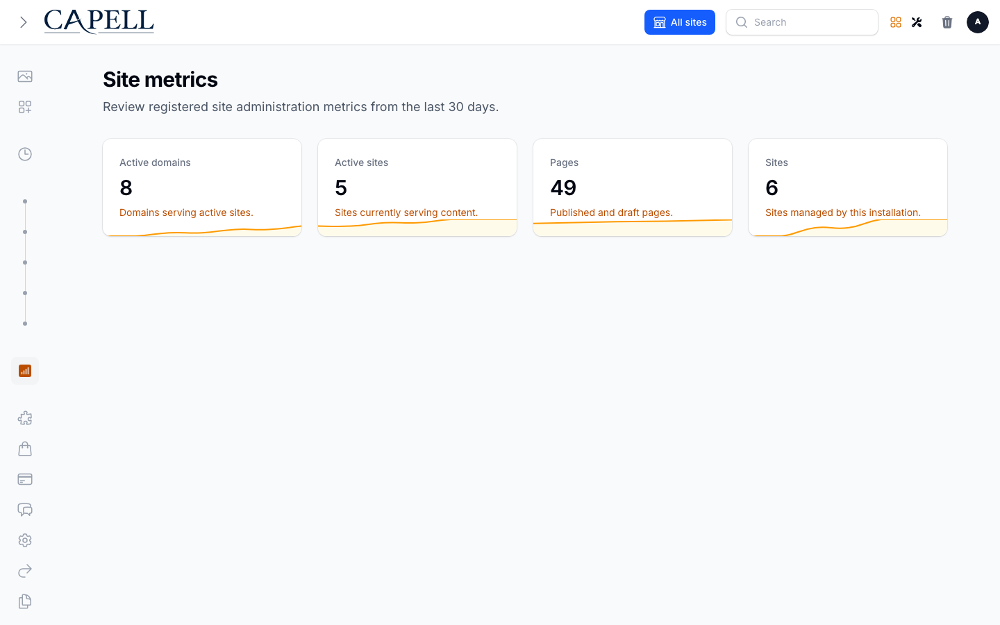

# Site metrics page

This capture shows the Admin package's registered site metrics surface running in the Capell workbench. The compact cards and daily sparklines shipped in [Core PR #370](https://github.com/capell-app/capell/pull/370). The [Capell homepage](https://capell.app/) is the real site represented by the product captures above.
