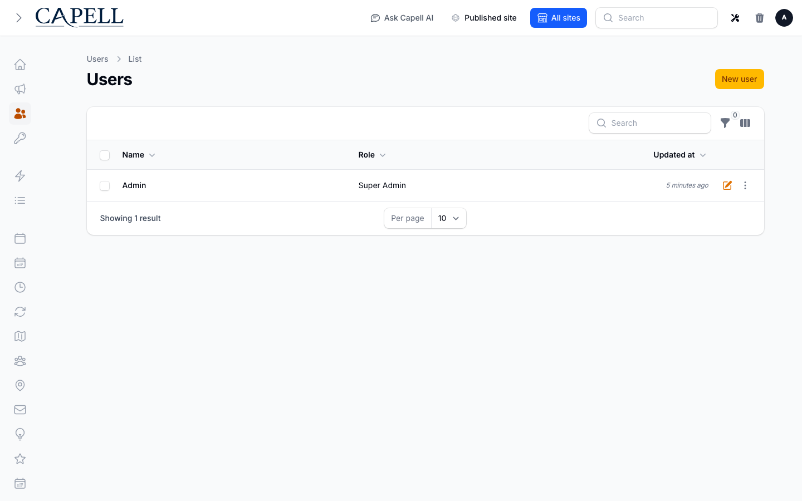
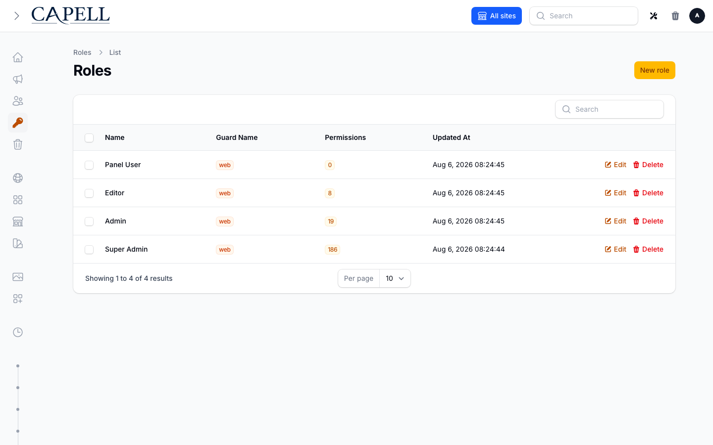
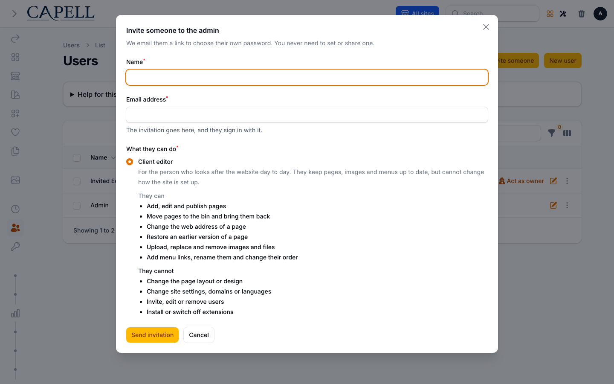
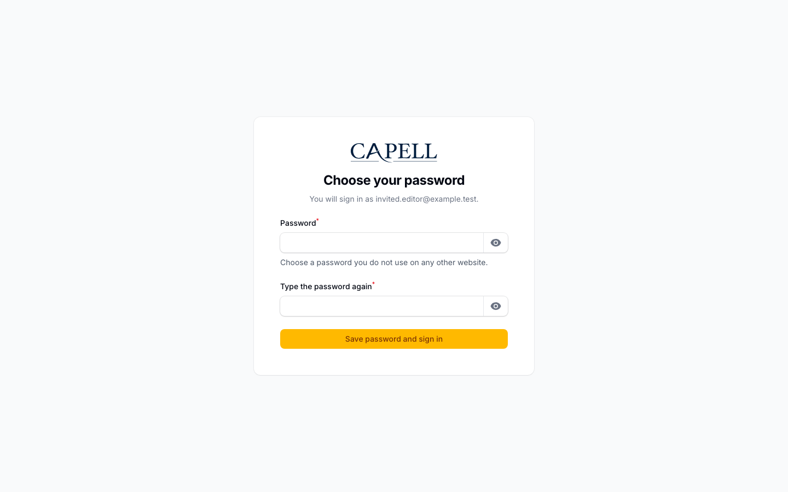
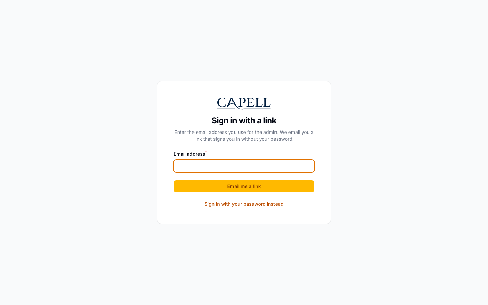
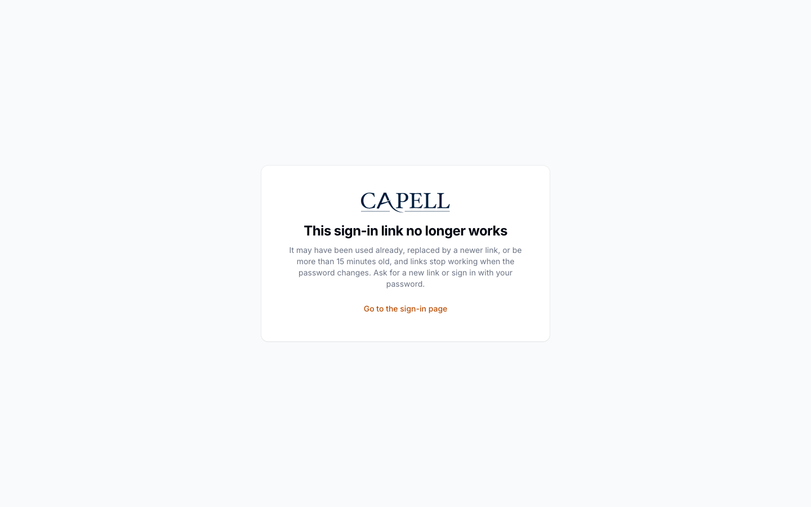

# Users and roles



Manage who can sign in to the admin and what they can do. Capell uses **site-scoped roles**: a person can have one set of permissions on Site A and a different set on Site B.



## Invite someone

Use **Invite someone** at the top of the Users list to send a link instead of setting a password for the person.



The person opens the link from their email and chooses their own password.



## Sign in with a link

A site can let people choose **Email me a sign-in link instead** on the login page. The option is off by default; set `CAPELL_ADMIN_LOGIN_LINK_EMAIL_REQUESTS=true` (config `capell-admin.login_links.email_requests`) to turn it on. While it is off, the login page shows no link option and the request page is not found. Capell emails a link that signs them in once, without their password. The page gives the same answer whether or not the address has an account, so nobody can use it to find out who has one.



Each link:

- works once, and only after the person presses **Sign in**, so mail scanners that open links cannot use it up
- expires after 15 minutes (`CAPELL_ADMIN_LOGIN_LINK_EXPIRES_IN_MINUTES`)
- stops working when a newer link is sent or the person's password changes
- signs in only people the panel admits. Anyone with two-factor authentication turned on must sign in with their password and code instead.



Operators and automated test harnesses can print a link from the command line instead of emailing one:

```bash
php artisan capell:admin-login-link editor@example.com
```

Treat the printed link like a password. The command works whether or not the login-page option is on. Set `CAPELL_ADMIN_LOGIN_LINKS_ENABLED=false` to turn links off entirely, including the command.

Requests from the login page are rate limited. Each address receives at most `capell-admin.login_links.max_emails_per_address` links (default 3), and each IP address may make `capell-admin.login_links.max_requests_per_ip` requests (default 10), in every `capell-admin.login_links.request_window_minutes` minutes (default 15). Requests over the per-address limit are dropped without a different answer, so the limit does not reveal who has an account.

## Add a user

1. Open **Users** in the admin sidebar.
2. Click the create action.
3. Fill **Name**, **Email**, and set a **Password** (and **Password confirmation**).
4. Assign one or more **Roles**.
5. Save. The user can now sign in to the admin panel (`/admin` by default; see [Admin domain and path](admin-domain.md)).

## Change a user's password

1. Open **Users** and edit the user.
2. Enter a new **Password** and **Password confirmation**.
3. Save. (Passwords are stored hashed; you cannot read an existing password back.)

## Manage roles

- Open **Roles** to create roles and choose the permissions each role grants.
- Assign roles to a user from the user's edit screen (**Roles** field), or per site from the **Manage site permissions** action on a site's edit page (see below).

## Give someone access to one specific site

Roles are scoped per site. To make someone an editor on just one site:

1. Open **Sites** and edit the target site.
2. Click **Manage site permissions**.
3. Add the user and assign their role for this site.

The same person can hold a different role on each site, or none.

## Restrict a page type to certain roles

On a page type's configurator tab you can choose which roles may see and edit pages of that type. Users without one of the listed roles cannot access those pages.

## Offboard someone

- Remove their roles to revoke access while keeping their account, or
- Delete the user from the **Users** list to remove the account entirely.

## Approval workflows and the RBAC model

- Approval workflows (submit → review → approve) are provided by the optional `capell-app/publishing-studio` package, not by core.
- For the underlying RBAC model (Spatie teams, policies, page-type restrictions) see the developer guide: [permissions and approval](../../packages/admin/docs/permissions-and-approval.md).
