# How a page edit reaches the public site

_Editing, recovery drafts, private previews and saved page content are distinct states. Public visibility determines which saved content visitors can access._

The panels follow the same editor state: scratch recovery restores the form, optional Peek previews an unsaved snapshot, and explicit Save validates and checks the lock before persistence. History is recorded after the write; a save can change content already visible to visitors. Publishing Studio is a separate optional workflow. Source: [Admin save gates](../../packages/admin/src/Filament/Resources/Pages/Pages/EditPage.php), [revision listener](../../packages/core/src/EventSourcing/Listeners/RecordPageRevision.php) and [Peek snapshot renderer](https://github.com/capell-app/capell-packages/blob/main/packages/filament-peek/src/Actions/RenderPagePreviewSnapshotAction.php).

[Canonical Mermaid source](../images/capell-page-editing-workflow.mmd) · [Page history and rollback](../development/page-event-history.md)
