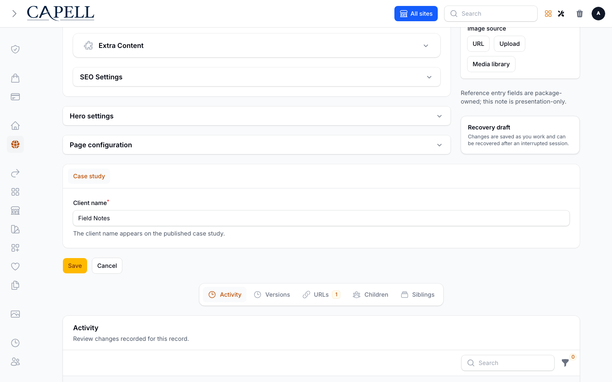
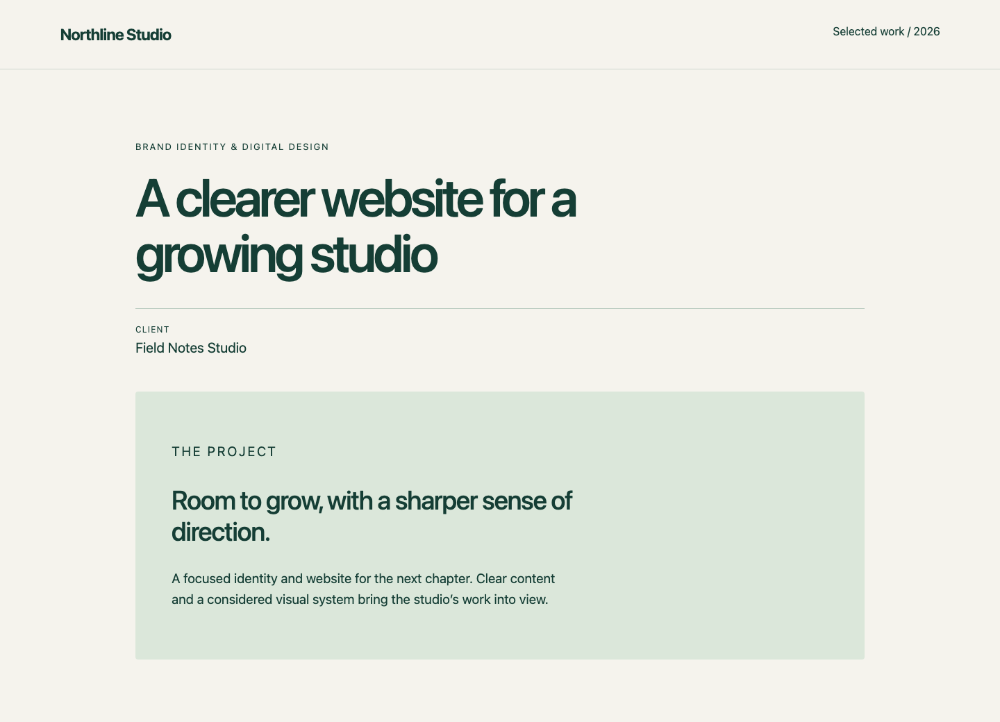
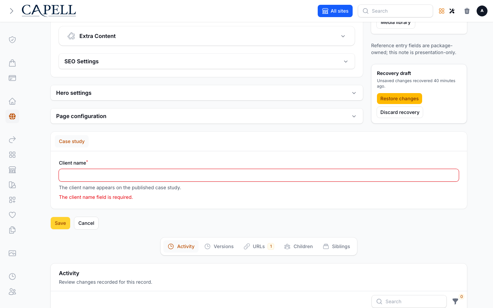
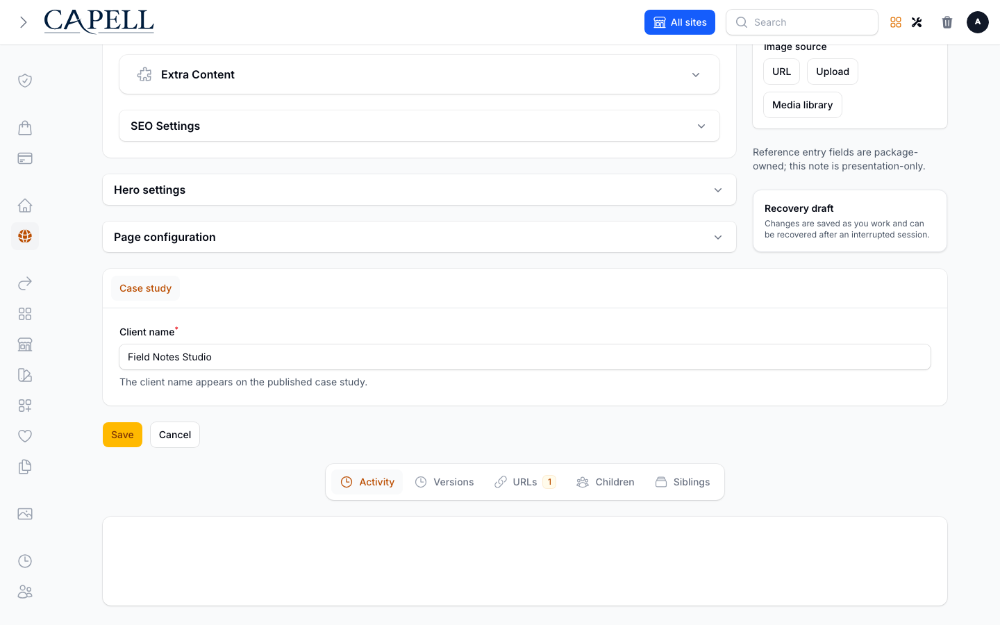

# Add a custom field to a page

Add **Client name** to a case-study page, save it in Capell, and display it on the website. The field belongs to your application. You do not edit Core, copy the Pages resource, or create a new Page model.

Capell supplies page editing, URLs and publication; your website supplies its content model and presentation. The same extension contracts are available to application developers and extension authors. Blog uses a specialised page configurator, SEO Suite adds page relationships, and component packages supply their own fields. [Compare the approaches and inspect those implementations](../packages/custom-page-fields.md).

Developers define the field and its rules; editors then manage its value through Pages. Blueprint settings select registered editors and property sets rather than generating arbitrary custom inputs.

## Choose the simplest route

This walkthrough uses a **schema extender** to add a tab to the existing page editor and **page metadata** to store a single value shared by all languages. These are two separate choices:

| Decision                      | Choice here                                      | Change it when                                                                                                                                         |
| ----------------------------- | ------------------------------------------------ | ------------------------------------------------------------------------------------------------------------------------------------------------------ |
| Where editors enter the value | An additional Case study tab                     | Use a configurator when your blueprint needs a different editor structure.                                                                             |
| Where the value lives         | `Page.meta.case_study.client_name`               | Use translation metadata for language-specific text, typed properties for structured property contracts, or related records for a richer domain model. |
| How visitors see it           | A public render-data contributor and your layout | Adapt the projection to your selected frontend runtime.                                                                                                |

See [all supported approaches](../packages/custom-page-fields.md) before choosing a different combination. Adding a field to a form does not create storage, a search index or an API response.

| Add the website's field                                                                                                                                                                                         | Display the value publicly                                                                                                                                                                                         |
| --------------------------------------------------------------------------------------------------------------------------------------------------------------------------------------------------------------- | ------------------------------------------------------------------------------------------------------------------------------------------------------------------------------------------------------------------ |
| [](../images/generated/admin/custom-page-fields-editor.png) | [](../images/generated/package-surfaces/custom-page-fields-public.png) |

_Client name appears beside the real Extension Cookbook sidebar contribution, loaded from pinned source into the isolated fixture. The public example displays the prepared client value._

## Before you start

Use an application with matching Capell Core, Admin and Frontend packages, a working site and an application-owned Blade layout. [Install Capell](install.md) first if needed. Run the commands below in that application, using its normal PHP runtime.

In **Blueprints**, create a page blueprint named **Case study**, with key `case-study`, using the default page configurator. [Blueprints](types.md) explains the editor and frontend settings. Then [create a page](create-your-first-page.md) using that blueprint; name the page **Field Notes** and use the slug `field-notes`. This example uses `/field-notes`; use the actual published URL shown by your site if it has a language or parent prefix.

The starter kit already includes a case-study configurator and a client field. If you are using it, inspect its [existing implementation](https://github.com/capell-app/starter-kit/blob/main/app/Filament/Configurators/Pages/CaseStudyPageConfigurator.php), then choose one implementation rather than adding a second client input. The walkthrough below uses a namespaced metadata key so the storage contract is explicit.

## 1. Define the editor field

Create `lang/en/case-study.php`:

```php
<?php

declare(strict_types=1);

return [
    'details' => 'Case study',
    'client_name' => 'Client name',
    'client_name_help' => 'The client credited on the public case study.',
];
```

Create `app/Filament/Extenders/CaseStudyPageSchemaExtender.php`:

```php
<?php

declare(strict_types=1);

namespace App\Filament\Extenders;

use Capell\Admin\Support\Schemas\AbstractPageSchemaExtender;
use Capell\Core\Models\Page;
use Filament\Forms\Components\TextInput;
use Filament\Schemas\Components\Tabs\Tab;
use Filament\Schemas\Schema;
use Override;

final class CaseStudyPageSchemaExtender extends AbstractPageSchemaExtender
{
    /**
     * @param array<int, mixed> $tabs
     * @return array<int, mixed>
     */
    #[Override]
    public function extendTabs(Schema $schema, array $tabs): array
    {
        $record = $schema->getRecord();

        if (! $record instanceof Page || $record->blueprint?->key !== 'case-study') {
            return $tabs;
        }

        return [
            ...$tabs,
            Tab::make(__('case-study.details'))->schema([
                TextInput::make('meta.case_study.client_name')
                    ->label(__('case-study.client_name'))
                    ->helperText(__('case-study.client_name_help'))
                    ->required()
                    ->maxLength(120),
            ]),
        ];
    }
}
```

The blueprint check limits the contribution to case studies. If the blueprint is shared by several sites, the field appears on all of them; add an explicit site condition if this is a single-site requirement.

`...$tabs` preserves existing contributions. `meta.case_study.client_name` targets the Page's existing JSON column because the tab is at the top level of the page form. No migration is needed. A bare `client_name` input would not create a column or make that attribute persist.

This example adds an **edit** tab. Create the page first, then enter the client name. It does not make Client name a required input in the create wizard or a publication gate. For requirements that apply to imports, API writes or publication, enforce them through the relevant write Action or a typed property requirement as well as the form.

## 2. Register the contribution

Add these imports to `app/Providers/AppServiceProvider.php`:

```php
use App\Filament\Extenders\CaseStudyPageSchemaExtender;
use Capell\Admin\Contracts\Extenders\PageSchemaExtender;
```

In its existing `boot()` method, add:

```php
$this->app->tag([
    CaseStudyPageSchemaExtender::class,
], PageSchemaExtender::TAG);
```

Keep the provider's existing registrations. If the application caches admin configurators, rebuild that cache after changing registration:

```bash
php artisan capell:admin-clear-cache
php artisan capell:admin-cache-configurators
```

Open **Pages → Field Notes → Case study**. Enter `Field Notes Studio`, save, leave the editor, and reopen it. The persisted value should still appear. Open a page using another blueprint and confirm that it has no Case study tab.

## 3. Prepare the public value

The editor and public output are independent. Pass only the client name to Blade, rather than exposing the Page model or the whole metadata object.

If your layout already receives an application-owned display object, extend its existing contributor instead of registering a second one. For example, the starter kit's `StudioRenderDataContributor` can read the namespaced value into its existing client output:

```php
'client' => data_get($context->page->meta, 'case_study.client_name', ''),
```

Its layout already displays `$studio->client`. Keep the contributor's cache declarations aligned with the data it reads. The complete implementation below is for an application that needs a new contribution.

The current Frontend package provides `PublicRenderDataContributor`. This API is marked experimental: check its interface against your installed version when upgrading. [The contract](../../packages/frontend/src/Contracts/PublicRenderDataContributor.php) separates the display value from its cache dependencies.

Create `app/Data/CaseStudyData.php`:

```php
<?php

declare(strict_types=1);

namespace App\Data;

final readonly class CaseStudyData
{
    public function __construct(public string $clientName) {}
}
```

Create `app/Support/CaseStudyRenderDataContributor.php`:

```php
<?php

declare(strict_types=1);

namespace App\Support;

use App\Data\CaseStudyData;
use Capell\Core\Models\Page;
use Capell\Frontend\Contracts\PublicRenderDataContributor;
use Capell\Frontend\Data\FrontendRenderContextData;
use Capell\Frontend\Data\PublicRenderDataCacheDependencyData;
use Capell\Frontend\Data\PublicRenderDataContributionData;
use Capell\Frontend\Data\PublicRenderDataContributionMetadataData;
use LogicException;
use Override;

final class CaseStudyRenderDataContributor implements PublicRenderDataContributor
{
    #[Override]
    public function key(): string
    {
        return 'case-study';
    }

    #[Override]
    public function supports(FrontendRenderContextData $context): bool
    {
        return ! $context->isError
            && $context->page instanceof Page
            && $context->page::class === Page::class
            && $context->page->blueprint?->key === 'case-study';
    }

    #[Override]
    public function cacheDependencyModelTypes(): array
    {
        return [Page::class];
    }

    #[Override]
    public function metadata(FrontendRenderContextData $context): PublicRenderDataContributionMetadataData
    {
        $page = $context->page;

        if (! $page instanceof Page) {
            throw new LogicException('Case study data requires a Page context.');
        }

        return new PublicRenderDataContributionMetadataData(
            fingerprint: hash('sha256', $this->clientName($context)),
            cacheDependencies: [
                PublicRenderDataCacheDependencyData::forModel($page),
            ],
        );
    }

    #[Override]
    public function contribute(FrontendRenderContextData $context): PublicRenderDataContributionData
    {
        return new PublicRenderDataContributionData(
            new CaseStudyData($this->clientName($context)),
        );
    }

    private function clientName(FrontendRenderContextData $context): string
    {
        $value = data_get($context->page?->meta, 'case_study.client_name');

        return is_string($value) ? $value : '';
    }
}
```

The registry calls this contributor only for contexts accepted by `supports()`. This example targets the ordinary Page class. If you support a custom Page subclass, update `supports()` and declare its exact model type in `cacheDependencyModelTypes()` too: dependency declarations are matched by class name. The fingerprint describes the value rendered; the dependency tells the render-data cache which model changes can invalidate it. If you later load Client records, declare those dependencies too. See [cache invalidation](../performance/cache-invalidation.md) for additional page/HTML cache integration.

Add the following imports to `AppServiceProvider`, then tag the contributor in its `register()` method:

```php
use App\Support\CaseStudyRenderDataContributor;
use Capell\Frontend\Contracts\PublicRenderDataContributor;
```

```php
$this->app->tag([
    CaseStudyRenderDataContributor::class,
], PublicRenderDataContributor::TAG);
```

## 4. Display it in your layout

In the application-owned Blade layout selected by the page's layout record, add this beside the case-study content:

```blade
@php ($caseStudy = $publicRenderData->extensionData('case-study'))

@if ($caseStudy !== null && $caseStudy->clientName !== '')
    <dl>
        <dt>{{ __('case-study.client_name') }}</dt>
        <dd>{{ $caseStudy->clientName }}</dd>
    </dl>
@endif
```

If the selected layout comes from an installed theme, register and select an application-owned view through `LayoutViewRegistry`; [Themes](../frontend/themes.md) explains the layout boundary. Keep the field presentation in your application's view rather than editing installed package files.

`$publicRenderData` is the prepared public render data passed to Capell's Blade layout. The template reads a display object and escapes its value. It performs no database query and exposes no field paths, record IDs or editor links.

If your application uses Inertia, an API or another renderer, project the same visitor-safe value through that runtime's response contract. Adding the Blade fragment does not change those responses.

## 5. Verify the whole journey

1. Save a client name, reopen the editor, and confirm persistence.
2. Clear the field and save. Confirm validation prevents that edit; enter a valid value again.
3. Publish the page through the normal workflow and open its published URL (for this example, `/field-notes`) in a private window. Confirm that the client name appears.
4. Change the name, save, and request the public page again. If HTML caching or static export is installed, verify the refreshed origin and regenerated output too.
5. Check another blueprint, another site where applicable, and a visitor without admin access. Confirm the field is scoped correctly and the public HTML contains no authoring state.

Automated tests should exercise those behaviours, including escaped output for a value containing HTML and absence of the contribution on other page blueprints. Form validation alone does not validate writes made by your own jobs or API.

| Validate an empty value                                                                                                                                                           | Save and reopen                                                                                                                                                                                          |
| --------------------------------------------------------------------------------------------------------------------------------------------------------------------------------- | -------------------------------------------------------------------------------------------------------------------------------------------------------------------------------------------------------- |
| [](../images/generated/admin/custom-page-fields-validation.png) | [](../images/generated/admin/custom-page-fields-reopened.png) |

_Submitting an empty value shows the required-field error. The persistence scenario changes the name through the editor, saves and follows the record breadcrumb to reopen the editor with Field Notes Studio retained._

## Reuse the field in an extension

For one website, the application classes above are sufficient. Extract them into a private or distributable extension when several websites need the same behaviour or the feature needs its own lifecycle.

Move the classes into the package namespace, load its translations and views, and register the same contributions from the package's **installed runtime**. An optional package's Composer-discovered provider may boot while the extension is disabled, so unconditional provider registration is inappropriate there. Use the [package provider lifecycle](../development/installed-runtime-lifecycle.md) and [extension tutorial](../packages/build-extension-end-to-end.md).

Keep the metadata path stable during extraction, or provide a data migration. Give the contributor a unique stable lowercase key. Test enabled and disabled states; disabling the extension removes its UI/output registrations, while stored data follows the package's documented retention policy.

## Reproduce the screenshots

Root documentation owns these four `custom-page-fields-*` entries in [the screenshot manifest](../screenshots.json). The [fixture](../../workbench/app/Support/CustomPageFieldsFixture.php) creates ordinary Pages, a Case study blueprint and a public layout; the [pinned extension source record](../../workbench/fixtures/extension-cookbook/provenance.json) identifies the genuine Cookbook contribution. Browser interactions select the field, submit validation, save and reopen through the normal editor. The public capture uses the ordinary anonymous frontend route.

The capture scenarios use independent seeded records. A fixture-only table configuration disables the Activity table's column chooser for those exact records; the table rows, relations and normal page editor remain in place. They load the pinned Cookbook contribution and translations without installing the full package. The automated workflow test additionally saves and requests the same page anonymously. These captures establish the demonstrated field behaviour, rather than complete editor or package lifecycle compatibility.

Run this only in an isolated, owned screenshot workbench with installed dependencies. The preparation wrapper recreates that checkout's screenshot database; it is inappropriate for a shared application or another session's runtime.

```bash
bash scripts/local-core-screenshots.sh --skip-install \
    --package documentation:custom-page-fields-editor \
    --package documentation:custom-page-fields-validation \
    --package documentation:custom-page-fields-reopened \
    --package documentation:custom-page-fields-public
```

The [accepted runner report](../screenshot-receipts/custom-page-fields.json) records the source and image digests for these captures. Use the shared runner's report and receipts to validate regenerated images. A manifest dry run does not establish browser behaviour. See [documentation visuals](../standards/documentation-visuals.md) for provenance and maintenance checks.

## Next

- [Choose another custom-field approach](../packages/custom-page-fields.md), including configurators, translations, typed properties, relationships and component fields.
- [Schema hooks](../../packages/admin/docs/schemas/hooks.md) for hook positions and relation managers.
- [Blueprints](types.md) for selecting editor and frontend behaviour.
