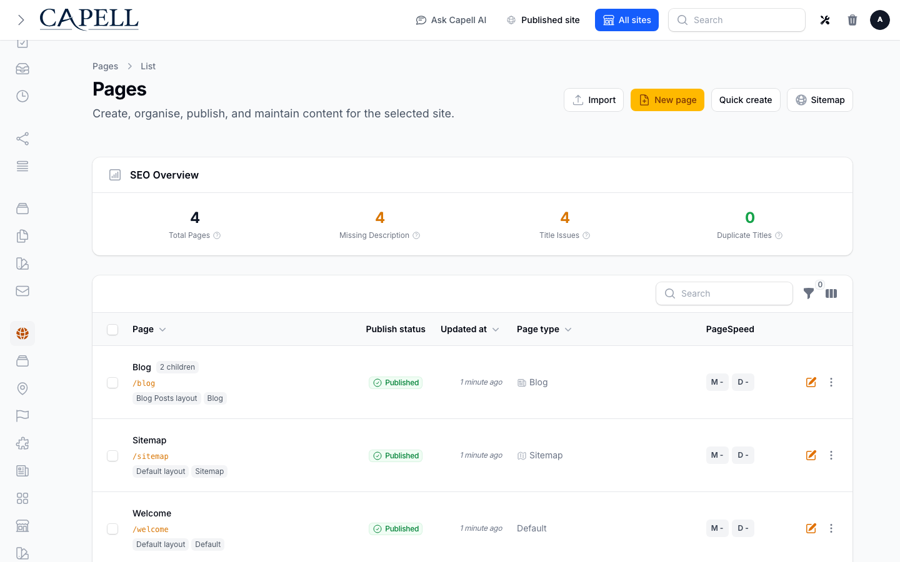
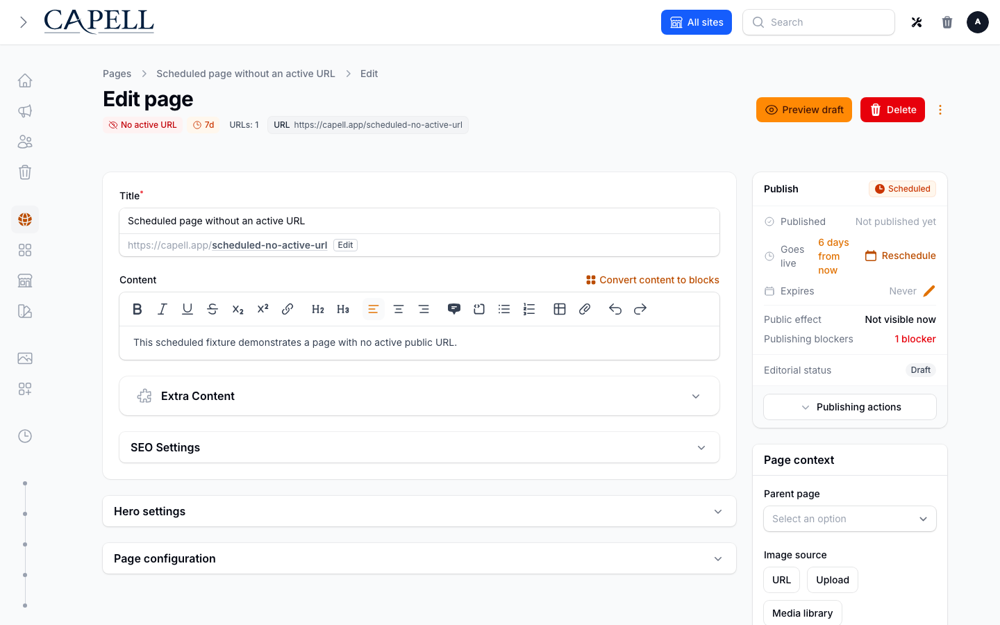

# Capell quickstart

> **Learn Capell · Stage 2 of 8 · about 20 min** · Previous: [Why Capell](why-capell.md) · [All stages](capell-learn.md) · Next: [Your first session](first-session.md)

Use this path to install the current 1.x Foundation in a fresh Laravel application, open a styled Pages workspace, publish your own page, and inspect its history. It selects Core, Admin, Frontend, Installer, and Marketplace, with the default theme and demo content.

The current 1.x Capell Foundation release is MIT-licensed and available through public Packagist packages without a Capell account. Paid marketplace packages use separate commercial terms and entitlement-scoped Composer access.

For an existing application, use the [Install guide](install.md#existing-laravel-applications) and take a database and media backup before running migrations.

## Before you start

Allow about ten minutes for the first Composer install.

| Requirement | Supported value                                                         |
| ----------- | ----------------------------------------------------------------------- |
| PHP         | 8.4+                                                                    |
| Laravel     | 13.x                                                                    |
| Filament    | Installed by the selected Capell Admin package; supported line `^5.7.6` |
| Node.js     | 20+                                                                     |
| Composer    | 2.7+                                                                    |
| Database    | MySQL 8+, MariaDB 10.5+, PostgreSQL 16+, or SQLite                      |

Required PHP extensions: `fileinfo`, `intl`, `mbstring`, `openssl`, `curl`, `simplexml`, and either `gd` or `imagick`.

Capell renders through this Laravel application. This quickstart does not create a hosted Capell account or a public content-delivery API.

## 1. Create the Laravel application

```bash
composer create-project laravel/laravel capell-site
cd capell-site
cp .env.example .env
php artisan key:generate
```

Configure `APP_URL` and a database in `.env`. SQLite is enough for a disposable local evaluation:

```bash
touch database/database.sqlite
```

```env
APP_URL=http://localhost:8000
DB_CONNECTION=sqlite
QUEUE_CONNECTION=sync
```

## 2. Run the guided installer

Require the public Installer package first. Do not run `filament:install --panels` separately: Admin is one of the packages selected and configured by `capell:install`.

```bash
composer require capell-app/installer
php artisan capell:install --demo --package-mode=all --theme=default --url=http://localhost:8000 --update-app-url
```

This command selects the full Foundation and default theme explicitly, skipping the suite question. `--url` sets the browser address and `--update-app-url` writes it to `.env`.

For this disposable local application:

- create an administrator with an email and strong local password;
- accept the preselected cache-clearing options;
- let Capell handle the homepage;
- review the site, database, packages, theme and planned host-file changes, then confirm **Install Capell with these settings?**.

Declining the final review applies no installation changes. Cache clearing also clears application data in the default cache store. For existing applications, return to the [Install guide](install.md#existing-laravel-applications).

The final output is part of the install contract. A healthy run ends in this order:

```text
Capell Install Health Summary
All checks passed.
✓ Installation complete!
Capell Install Handoff
```

If a required package lifecycle, asset build, permission sync, or health check fails, the command exits non-zero and withholds the success message. Follow the printed `Fix:` instruction, then rerun the installer; do not treat a partial run as production-ready.

The handoff lists the installed packages, Admin and public URLs, first-page state, warnings, a short **What next** list (sign-in, first page, theme, content packages) and the next action. Use those URLs to check your installation.

## 3. Start the application

Before opening Admin or the public page, apply the Frontend dependency plan and build the production assets unless the installer recorded a successful resource rebuild:

```bash
php artisan capell:frontend-after-install --apply --no-interaction
php artisan serve
```

The Frontend command applies the dependency and asset plan and builds once. With `--no-interaction`, omitting `--apply` only prints the plan; interactive runs ask before applying. If the install handoff records a successful resource rebuild, skip that command and run `php artisan serve`.

Open:

- `http://localhost:8000/admin` and sign in with the administrator created by the installer;
- `http://localhost:8000` to see the seeded public page.

The Admin package should present a styled Pages workspace—not an unstyled Laravel or Filament shell:

<picture>
  <source media="(prefers-color-scheme: dark)" srcset="../images/admin-pages-list-dark.png">
  
</picture>

[Light](../images/admin-pages-list.png) · [Dark](../images/admin-pages-list-dark.png)

_Your first check: Pages opens with its normal styling and the seeded records are visible._

## 4. Publish your first page and inspect history

Demo content lets you inspect the workspace. Create your own saved page for this check; leave any read-only demo records alone.

1. Select the intended site, open **Pages**, and create a page using the [first-page guide](create-your-first-page.md). Choose a suitable page type, title and slug, then add a short paragraph and **Save as draft**.
2. Follow [Preview and publish](create-your-first-page.md#preview-and-publish): check the signed draft preview, inspect the Publish panel and its blockers, then **Save and Publish**. Saving a draft or scheduling it for later does not make it public now.
3. Open the page's canonical public URL in a private browser window with no Admin session. Your paragraph should appear at the ordinary site URL; the signed preview is a separate check.
4. Edit one sentence on the published page and **Save**. Reload its public URL, then open the page's history relation and inspect the before/after change. Preview a rollback and cancel unless you deliberately want to apply it.

[](../images/generated/admin/admin-page-edit-form.png)

Compare your result with the [published public-page example](../frontend/guide.md). Appearance depends on the selected theme and layout.

Page rollback restores the page and its owned content relationships. It does not restore the application database, media store, analytics counters or infrastructure. Read [Page event history](../development/page-event-history.md#previewing-and-applying-rollback) for the recovery boundaries.

## 5. Confirm health

```bash
php artisan capell:doctor
```

If you switch from `QUEUE_CONNECTION=sync` to `database` or `redis`, keep a worker running:

```bash
php artisan queue:work
```

Before production, also configure and prove the separate [database and media backup](../operations/backups.md) path. Page history is not disaster recovery.

## First-run fixes

| Symptom                                                | Action                                                                                                          | Read next                                                                                                         |
| ------------------------------------------------------ | --------------------------------------------------------------------------------------------------------------- | ----------------------------------------------------------------------------------------------------------------- |
| `php artisan` is not executable or writable paths fail | `chmod +x artisan && chmod -R u+rwX storage bootstrap/cache`                                                    | [Permissions troubleshooting](../operations/troubleshooting.md#php-artisan-says-permission-denied)                |
| A queued publish never finishes                        | Start `php artisan queue:work`                                                                                  | [Published pages never generate](../operations/troubleshooting.md#published-pages-never-generate)                 |
| The public page remains stale                          | Follow the refresh procedure for the installed cache package, then verify the canonical response                | [Published pages still show old content](../operations/troubleshooting.md#published-pages-still-show-old-content) |
| A package class is missing after Composer              | `composer dump-autoload && php artisan optimize:clear`                                                          | [Package discovery](../packages/debugging-package-discovery.md)                                                   |
| Frontend CSS is missing                                | `php artisan capell:frontend-install`, then run the application's normal npm build if the installer requests it | [Themes and frontend assets](install.md#themes-and-frontend-assets)                                               |
| The installer stops at health review                   | Run the exact `Fix:` command shown, then rerun `php artisan capell:doctor`                                      | [Site Health](../operations/site-health.md)                                                                       |

## Other install paths

### Suites and package choices

For a guided suite or custom package selection, omit `--package-mode=all` and `--theme=default` and follow the installer prompts. Suites can recommend optional extensions; review their package and licence requirements before accepting downloads. See [Run the CLI installer](install.md#3-run-the-cli-installer) and [Manual package selection](install.md#manual-package-selection).

Use [Useful installer options](install.md#useful-installer-options) for profiles, explicit recommendations and `--plan`. The [Browser installer](install.md#browser-installer) has its own reviewed-settings flow.

Hosts can replace the suite definitions through `capell.install.recommendations`, `config/capell-install-recommendations.php` or `capell-install-recommendations.json`.

### Ports and asset pipelines

For Docker, set `--url` to the published host port rather than assuming the container port is reachable. See [container development](../development/container-development.md).

Browser **Rebuild resources** uses the npm-only build path. pnpm, Yarn and Bun applications should leave it unselected and apply the explicit Frontend plan. Prepared asset pipelines are covered in [Themes and frontend assets](install.md#themes-and-frontend-assets).

### Reproducible non-interactive smoke command

CI and release verification can use the same public path without prompts:

```bash
php artisan capell:install \
  --fresh=force \
  --demo \
  --package-mode=all \
  --theme=default \
  --seed \
  --url=http://localhost:8000 \
  --name="Capell evaluation" \
  --email=owner@example.test \
  --password='replace-this-local-password' \
  --clear-cache \
  --install-welcome-route \
  --no-interaction
```

This command is destructive because `--fresh=force` rebuilds the database. Use it only in a disposable application or isolated CI database.

CI can persist the redacted install handoff with `--handoff-json=storage/app/capell-install-handoff.json`. A successful local evaluation still needs the separate [production verification](install.md#production-verification) checks before deployment.

## Next

- [Your first session](first-session.md) (Learn Capell stage 3) tours Admin before you create a page.

Dive deeper (optional):

- [Install matrix](install-matrix.md) for the other install paths.
- [Theme Library](../admin/theme-library.md) to change how the site looks.
- [Troubleshooting](../operations/troubleshooting.md) for first-run problems.
- [Upgrading and rollback](../operations/upgrading.md) and [Backups](../operations/backups.md) before the site is real.
