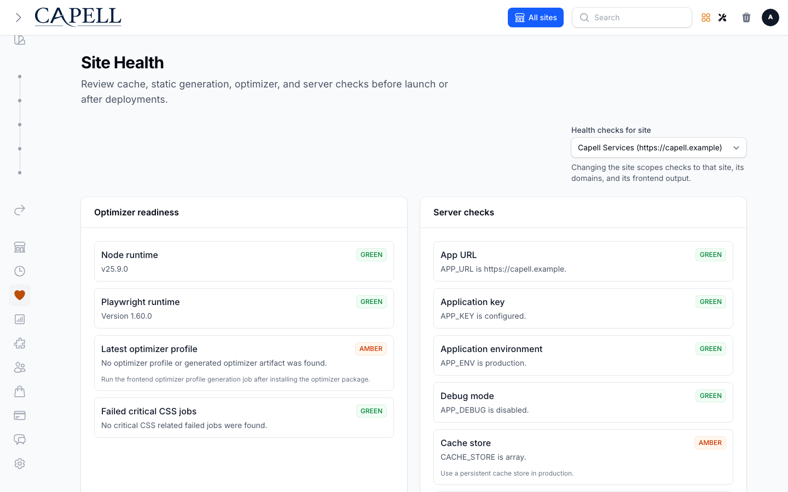
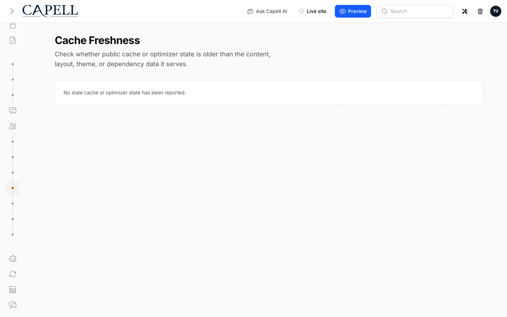
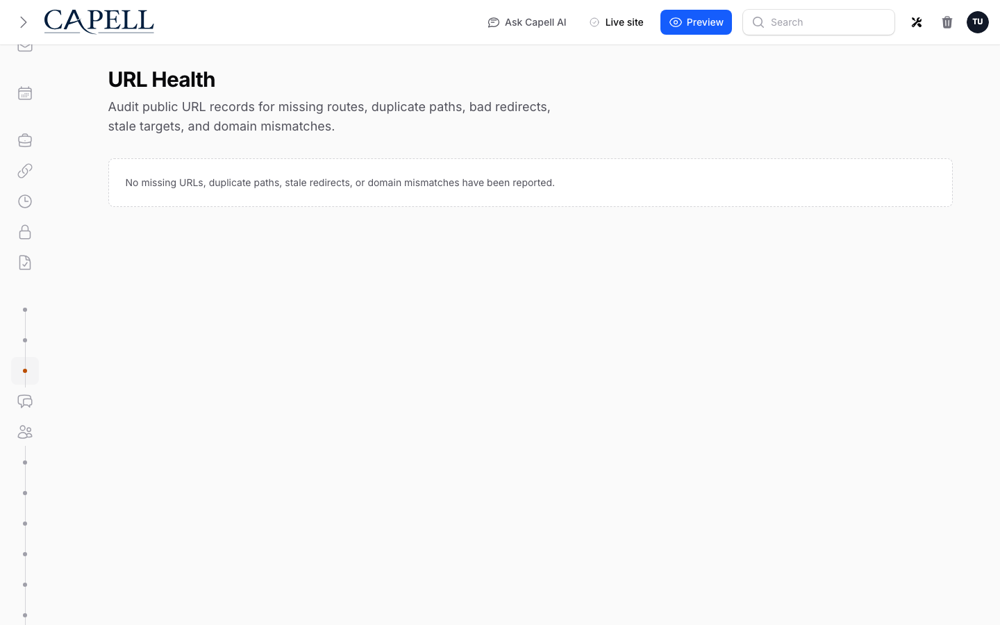
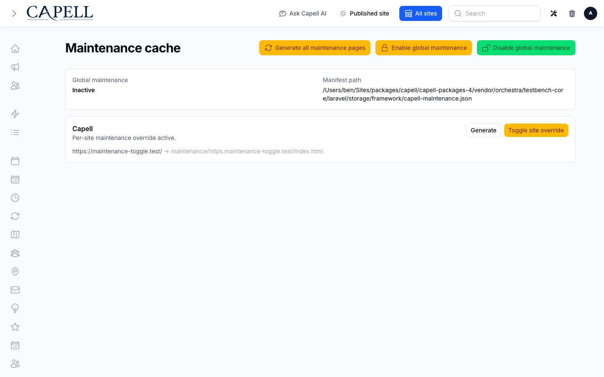

# Site Health

Use Site Health before serving a Capell site from production domains and after any deployment that changes frontend rendering, cache behaviour, static output, optimiser jobs, queues, or server configuration.

## Admin diagnostics

Open **Insights & health → Site Health** in the Capell admin before launch and after deployments that change public rendering, queues, cache, static output, or frontend assets.

<picture>
  <source media="(prefers-color-scheme: dark)" srcset="../../packages/admin/docs/images/screenshots/site-health-page-dark.png">
  
</picture>

[Light](../../packages/admin/docs/images/screenshots/site-health-page.png) · [Dark](../../packages/admin/docs/images/screenshots/site-health-page-dark.png)

_The aggregate page is the release-oriented view; focused reports below explain individual cache and URL findings._

The page aggregates operational checks that affect whether public traffic can be served safely:

- Public HTML cache status for each cacheable page URL: `HIT`, `MISS`, or `BYPASS`, with the cache file path and generated timestamp where available.
- Public-output safety checks for cached HTML that contains authoring markers or signed admin URLs.
- Static generation checks, including the current generation lock, the latest generated cache timestamp, and failed static generation jobs.
- Optimiser readiness for Node, Playwright, generated optimiser artefacts, and failed critical CSS jobs.
- Server checks for Laravel runtime basics: `APP_URL`, `APP_KEY`, `APP_ENV`, `APP_DEBUG`, cache/session/queue drivers, database-backed cache and queue tables, scheduler visibility, failed-jobs table, trusted proxy config, and writable paths.

Treat red checks as release blockers. Treat amber checks as deployment risks that need either remediation or an explicit operational decision.

## Focused health pages

Site Health is the sidebar entry point for operational checks. Enabled extensions add focused subpages while keeping their own access permissions:

- **Cached pages**: inspect cached URLs and the content they depend on, and clear an outdated saved copy.
- **Maintenance cache**: prepare maintenance pages and control global or per-site maintenance mode.
- **Site monitor**: inspect public URL checks, certificate and domain expiry, and open incidents.
- **Media Health**: investigate missing or unhealthy media.
- **System Health**: review setup, alerts, content integrity, migrations, configuration drift, cache and asset-build widgets.
- **Security**: review security weaknesses, evidence and approved automatic fixes in the Security group.
- **Queue Health**: inspect pending work and failed background jobs.

If an operator can access a focused page but lacks permission for the overview, its navigation link remains available independently.

## Status meanings

| Status            | Meaning                                                                                                                         | Action                                                                 |
| ----------------- | ------------------------------------------------------------------------------------------------------------------------------- | ---------------------------------------------------------------------- |
| `GREEN` or `HIT`  | The check is healthy or the cache file exists.                                                                                  | No action needed beyond normal release verification.                   |
| `AMBER` or `MISS` | The site can usually keep serving traffic, but a dependency, cache file, generated artifact, or runtime signal needs attention. | Review the remediation text and decide whether to fix before release.  |
| `RED` or `BYPASS` | A safety guard, failed job, writable path, or cacheability issue can affect public delivery.                                    | Treat as a blocker unless there is a deliberate operational exception. |

## Feature areas

**Cache status** lists every enabled, non-redirect page URL with its site, layout, public URL, cache status, cache file path, and generated timestamp. Use it to spot URLs that are expected to be cacheable but are missing files, bypassing cache, or tied to an uncached domain.

[](../images/generated/admin/cache-freshness-report.png)

_Healthy looks like no cache or optimiser state older than the content, layout, theme, or dependency data it serves._

**Public-output safety** scans cached public HTML for authoring markers and signed admin URLs. A red result means unsafe admin/editor details reached cacheable output and the affected cache file should be cleared after the source leak is fixed.

**URL health** checks for missing routes, duplicate paths, bad redirects, stale targets, and domain mismatches. It is the URL-specific report; SEO Audit remains a separate companion-package concern.

[](../images/generated/admin/url-health-report.png)

_Healthy looks like an empty report: every public URL resolves uniquely, redirects point at current targets, and domains match their site records._

**Static generation** reports the static-site generation lock, newest generated public cache timestamp, and failed jobs related to static generation. Use it after cache clears, full static builds, or failed deployment jobs.

**Optimiser readiness** checks Node, Playwright, optimiser artefacts, and failed critical CSS jobs. Missing optimiser tooling is amber when the site can still serve normal CSS and JavaScript, but failed critical CSS jobs should be investigated before relying on generated assets.

**Server checks** cover the Laravel and filesystem basics Site Health can inspect locally: `APP_URL`, `APP_KEY`, `APP_ENV`, `APP_DEBUG`, cache store, session driver, queue connection, scheduler visibility, database-backed cache and queue tables, failed-jobs table, trusted proxy config, writable `storage`, and writable `bootstrap/cache`.

A failing trusted proxy check on a site behind a CDN or load balancer means Laravel is reading the proxy's address and scheme instead of the visitor's, which breaks generated HTTPS URLs and collapses every visitor into one IP for rate limiting. Fix it in `bootstrap/app.php` — see [Behind a proxy or CDN](going-live.md#behind-a-proxy-or-cdn).

## Screenshot coverage

The Site Health page is included in the admin screenshot manifest as `site-health-page`. Regenerate admin screenshots after UI changes so the operations docs show the current cache table and health sections:

```sh
npm run screenshots
```

## Public frontend safety

- Keep frontend authoring as a post-load admin feature. Public Blade, theme output, cached HTML, and static-site output must not contain edit controls, editor JavaScript, signed admin URLs, model IDs, field paths, permission names, package names, or authoring selectors.
- Capell blocks static HTML cache writes when a rendered HTML response contains explicit authoring markers such as `data-capell-authoring`, `data-field-path`, `data-model-id`, `data-capell-editor-url`, or a signed `/admin/...signature=` URL.
- Responses blocked by that guard are returned with `Cache-Control: private, no-store` and `X-Frontend-Cache: BYPASS`, so a CDN or browser should not store the unsafe output.
- If a package adds its own authoring attributes, append them to `capell-frontend.public_html_authoring_markers`.

## Cache and static output

<picture>
  <source media="(prefers-color-scheme: dark)" srcset="../images/generated/admin/html-cache-maintenance-dark.png">
  
</picture>

[Light](../images/generated/admin/html-cache-maintenance.png) · [Dark](../images/generated/admin/html-cache-maintenance-dark.png)

_Healthy looks like deliberate global and per-site maintenance state, with generated paths matching the site being operated. This screen belongs to the optional HTML Cache package rather than Core._

- Set `CAPELL_HTML_CACHE=true` and `CAPELL_WRITE_HTML_CACHE=true` only when the installed HTML-cache/static package owns and documents a writable cache disk.
- Configure the web server to serve generated static HTML only after the installed cache package documents the path and the safety tests pass for the site and installed packages.
- With `capell-app/html-cache` installed, follow the [stale public HTML refresh procedure](troubleshooting.md#published-pages-still-show-old-content) after changes to public Blade, themes, layouts or frontend assets: mark stale, process stale URLs, verify canonical origin bytes, then purge an edge cache only if configured.
- Static generation is a separate operation; an ordinary `capell:static-site` run can read existing cached HTML and does not establish freshness.
- Keep queues running for package jobs that purge CDN cache, generate assets, or refresh static output.

## Server load monitor

Capell records one reading of the server every minute from the scheduler: load against the number of CPU cores, available memory, swap, and what each scheduler run costs. When load stays high, the dashboard shows a warning above everything else and **Site Health → Server load** shows the readings for each server, the busiest processes and the slowest scheduled tasks. `php artisan capell:doctor` reports the same result as `core.host.load`, an advisory check that never blocks a deployment.

The monitor takes its readings inside the scheduler process, so it adds no PHP process of its own. It needs the scheduler to be running; without it no readings are recorded and the check reports that none exist yet.

### Why a busy scheduler shows up here

Every scheduled command starts its own `php artisan` process, and each one boots the whole application before it does any work. On a small server a dozen per-minute commands can use more CPU than the site's web requests. Each reading therefore records how many processes a scheduler run started and how many CPU seconds the run used, so a server can look idle between minutes and still be overloaded at the start of each one.

To reduce the cost:

- Run cheap checks less often. A command that polls every minute rarely needs to.
- Run work inside the scheduler process with `Schedule::call()` or `Schedule::job()` instead of `Schedule::command()` where the work does not need its own process.
- Enable the CLI opcache file cache for the scheduler (`opcache.enable_cli=1` and `opcache.file_cache=<writable directory owned by the scheduler user>`). CLI opcache memory is lost when each process exits, so only the file cache avoids compiling the framework again for every task. Give the directory to the scheduler user alone, because PHP runs the code stored in it.

### Warning levels

A reading counts only when the last few agree, so a single busy minute does not raise a warning. Once raised, the status holds until the same number of readings agree it has cleared.

| Signal            | Warning                                            | Critical                                           |
| ----------------- | -------------------------------------------------- | -------------------------------------------------- |
| Load              | Five-minute load is 0.75 per core or more          | Five-minute load is 1.5 per core or more           |
| Memory            | 15% or less available                              | 7% or less available                               |
| Swap              | 60% or more in use                                 | 90% or more in use                                 |
| Scheduler CPU     | One run uses 30% of what the cores supply a minute | One run uses 60% of what the cores supply a minute |
| Scheduler overlap | A run takes 50 seconds or more                     | A run takes 90 seconds or more                     |

### Notifications

Notifications are off by default. Switch them on and choose where messages go. A message is sent when a problem is first confirmed or gets worse, as a reminder while it lasts, and once when it clears. Messages name the readings that crossed a limit and the busiest processes, without command arguments.

| Variable                                     | Default   | Used for                                                                                                     |
| -------------------------------------------- | --------- | ------------------------------------------------------------------------------------------------------------ |
| `CAPELL_HEALTH_HOST_ENABLED`                 | `true`    | Turn the monitor, dashboard warning and doctor check on or off                                               |
| `CAPELL_HEALTH_HOST_SUSTAINED_SAMPLES`       | `5`       | Consecutive one-minute readings that must agree before the status changes                                    |
| `CAPELL_HEALTH_HOST_HISTORY_SAMPLES`         | `60`      | How many recent readings to keep for each server                                                             |
| `CAPELL_HEALTH_HOST_LOAD_WARNING`            | `0.75`    | Five-minute load per core that raises a warning                                                              |
| `CAPELL_HEALTH_HOST_LOAD_CRITICAL`           | `1.5`     | Five-minute load per core that raises a critical alert                                                       |
| `CAPELL_HEALTH_HOST_MEMORY_WARNING`          | `15`      | Percentage of memory still available at or below which a warning is raised                                   |
| `CAPELL_HEALTH_HOST_MEMORY_CRITICAL`         | `7`       | Percentage of memory still available at or below which a critical alert is raised                            |
| `CAPELL_HEALTH_HOST_SWAP_WARNING`            | `60`      | Percentage of swap in use that raises a warning                                                              |
| `CAPELL_HEALTH_HOST_SWAP_CRITICAL`           | `90`      | Percentage of swap in use that raises a critical alert                                                       |
| `CAPELL_HEALTH_HOST_SCHEDULER_CPU_WARNING`   | `0.3`     | Share of one minute's CPU supply that one scheduler run may use before a warning                             |
| `CAPELL_HEALTH_HOST_SCHEDULER_CPU_CRITICAL`  | `0.6`     | Share of one minute's CPU supply that one scheduler run may use before a critical alert                      |
| `CAPELL_HEALTH_HOST_SCHEDULER_WALL_WARNING`  | `50`      | Seconds one scheduler run may take before a warning                                                          |
| `CAPELL_HEALTH_HOST_SCHEDULER_WALL_CRITICAL` | `90`      | Seconds one scheduler run may take before a critical alert                                                   |
| `CAPELL_HEALTH_HOST_NOTIFY`                  | `false`   | Send messages when the status changes                                                                        |
| `CAPELL_HEALTH_HOST_NOTIFY_CHANNELS`         | `mail`    | Comma-separated channels: `mail`, `webhook`                                                                  |
| `CAPELL_HEALTH_HOST_NOTIFY_MAIL_TO`          | empty     | Comma-separated email addresses that receive the messages                                                    |
| `CAPELL_HEALTH_HOST_NOTIFY_WEBHOOK_URL`      | empty     | HTTP or HTTPS address that receives a JSON body with a `text` field, as Slack and Mattermost webhooks accept |
| `CAPELL_HEALTH_HOST_NOTIFY_MINIMUM`          | `warning` | Lowest status that sends a message: `warning` or `critical`                                                  |
| `CAPELL_HEALTH_HOST_NOTIFY_REMINDER_MINUTES` | `360`     | Minutes between reminders while a problem lasts; `0` turns reminders off                                     |
| `CAPELL_HEALTH_HOST_NOTIFY_RECOVERY`         | `true`    | Send one message when the server returns to normal                                                           |

On a multi-node installation each server records its own readings under its node name (`CAPELL_NODE_ID`, or the host name) in the shared cache, so one dashboard shows every server. Readings live in the cache store only; clearing the cache loses the recent history and nothing else.

## Optimiser and assets

- Treat frontend optimisation failures as job failures. Public pages should continue to load normal CSS and JavaScript rather than falling back to generated critical CSS.
- Install the Node and Playwright runtime required by the frontend optimiser on workers that generate critical CSS.
- Prefer small, relevant CSS and JavaScript files for HTTP/3. Add profile bundling only when production metrics show it is necessary.

## Verification

Run the narrow safety checks before release:

```sh
vendor/bin/pest packages/frontend/tests/Unit/Security/PublicHtmlSafetyInspectorTest.php packages/frontend/tests/Unit/Loader/PageCachePolicyTest.php packages/frontend/tests/Feature/Cache/PageCacheInvalidatorTest.php --configuration=phpunit.xml
```

Then run package-level or full-suite checks based on the release scope:

```sh
vendor/bin/pest packages/frontend/tests --configuration=phpunit.xml
composer preflight
```

## Deprecated features

When code uses a surface that Capell or an extension has deprecated, it is recorded with its replacement and its removal. `php artisan capell:doctor` lists them under `core.extensions.deprecations` and `php artisan capell:extension-audit` lists them as warnings. Neither blocks a deployment, but each listed use stops working at its removal. Extensions record a use with `Deprecations::trigger($surface, $replacement, $removal)`. A deprecated route uses the `capell.deprecated:<surface>,<since>,<sunset>,<replacement>` middleware, which also sends the `Deprecation`, `Sunset` and, for an address replacement, `Link` headers. Check that an extension is installed and enabled with `ExtensionPresence::isActive($composerName)` rather than asking Composer.
