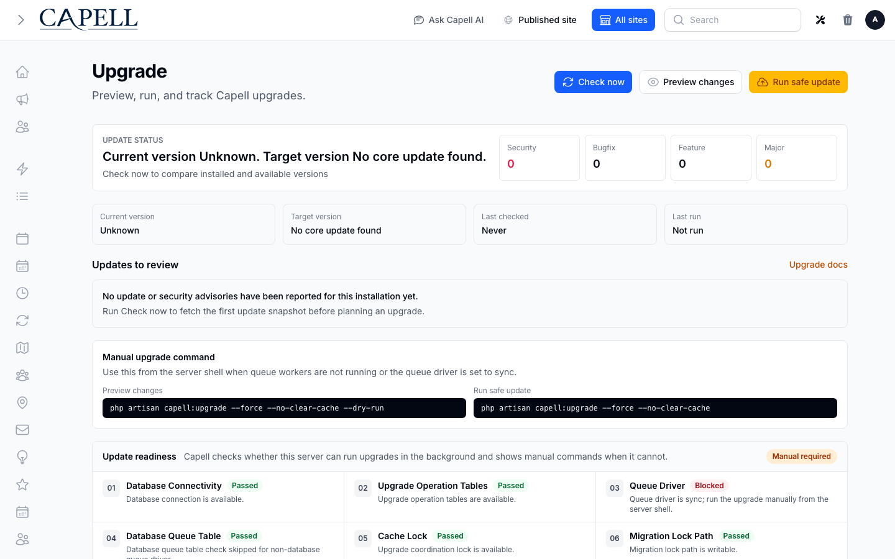

# Upgrading Capell

## Admin upload ownership registry

This Admin update adds `admin_upload_grants`; it does not alter existing content
or media tables. Apply the additive migration **before enabling upload edits on
any node running the new code**, and before enabling its scheduled prune command.
All application nodes must share the registry's default database connection. The
registry honours the configured database table prefix and works with transient
cache stores, including `array`.

Use the normal Capell upgrade flow to publish and run package migrations.
Direct `capell:admin-install` and `capell:admin-upgrade` also publish and run the
Admin schema. Vendor publication with `--tag=capell-admin-migrations` keeps the
same canonical migration filename as the package publisher; migrate it before
serving requests if publishing manually. For a
staged deployment, run `php artisan capell:upgrade --force` against the new release
while upload editing is paused, then switch application nodes to the new release and resume editing. Existing cache-backed
retry grants are not migrated: complete or re-upload pending unsaved uploads
before the switch. Persisted content paths remain valid.

Keep Laravel's scheduler running: `capell:admin-prune-upload-grants` removes a
bounded batch of abandoned expired grants hourly, with additional bounded pruning
when grants are issued. See [upload ownership](../../packages/admin/docs/upload-ownership.md)
for isolation, expiry and cleanup behaviour. Rolling code back can leave this
additive table in place; dropping it discards all pending retry grants.

## Admin authorisation and domain claims

Review custom roles when deploying the authorisation update. Inline creation of
Blueprints, Themes and Languages now requires the corresponding `Create:Blueprint`,
`Create:Theme` or `Create:Language` permission; page editing alone does not grant it.
Inline edits require their resource's update permission. Site and Layout bulk
restoration and permanent deletion require `RestoreAny:Site`, `ForceDeleteAny:Site`,
`RestoreAny:Layout` and `ForceDeleteAny:Layout` respectively. Site replication also
requires `Replicate:Site`, site access and permission to create sites. Individual
record checks continue to apply to bulk actions. Preserve deliberate restrictions
when updating custom roles; do not grant every permission to restore old UI access.
Explicit host policies for a model or its ancestors take precedence over Capell's
default policies.

Run the Core migrations before accepting domain writes or site restorations. The
`site_domain_claim_locks` table contains a seeded mutex row used by domain saves,
individual restores and site cascade restores in the same database transaction.
Do not delete that row. All origins share this lock because a wildcard scheme or
host can overlap a more specific claim. An inaccessible site's origin cannot be
claimed by choosing another path; refused cascade restores leave the entire
batch deleted. Trusted integrations that write domains must use model saves or
the restore action, rather than bulk SQL updates that bypass model guards.

Marketplace install, update and licence mutations now enforce the extension
management permission at their web entry points. These guards do **not** cancel
operations already queued before deployment or before a role was revoked. Review
and explicitly cancel pending operations through the owning queue/operation
workflow if they must not run, and restart workers onto the deployed code.

Browser removal of the installer requires the explicit
`CAPELL_SERVER_SIDE_TOOLING=true` opt-in as well as the existing post-install
session grant or global administrator access. Keep this disabled on immutable
releases and remove the installer during the build instead. A refused or failed
browser removal retains the session grant so the operator can correct the host
configuration and retry; successful removal consumes it.

## Installer account collisions and Marketplace update safety

Creating a primary installer account now rejects an email address that already
belongs to an account. To use that account, select the existing user by ID instead
of submitting it as a new user. Starter users whose email addresses already exist
are skipped; installation does not change those accounts' passwords, email
verification or roles. Failed creation and initial email verification roll back
together on the configured user model's database connection, so creation can be
retried without leaving an unfinished account that collides with the retry.

Marketplace updates must use constraints that allow only versions newer than the
installed version. This is checked again under the Composer operation lock before
execution or deployment publication, including for attempts persisted before this
upgrade and retries. An attempt that was safe when acquired can therefore fail if
another operation has since advanced the installed version. Request a fresh update
authorisation for the current installation; retrying the same unsafe constraint
does not bypass the check. These changes require no schema or stored payload
migration.

## Admin view escaping fixes

If your application overrides Capell Admin Blade views under
`resources/views/vendor/capell-admin`, port the escaping changes from these
package views into your overrides when upgrading:

- `components/forms/site/site_domain_item_label.blade.php`
- `components/forms/slug-input.blade.php`
- `components/tables/columns/language-flags.blade.php`
- `components/tables/columns/locale-flags.blade.php`

Use escaped Blade attributes for the slug input's `placeholder` and `autocomplete`.
For flag tooltips, pass `e($language->name)` (or the equivalent related language
name) to `x-tooltip.raw` and retain the flag renderer's attribute escaping. Both
layers are required: the browser decodes the attribute before the tooltip renders
its value as HTML. Keep names unchanged in storage and escape them at rendering
boundaries. Package updates do not replace application view overrides; compare
each override with the updated package view rather than overwriting customisations.
The upgrade dry run lists published Admin views that differ from the installed
package and views whose upstream file cannot be compared. Differences may be
intentional; review them for upstream security and behaviour changes. An
unavailable package view directory is reported as unknown.

## Frontend resource graph breaking change

The legacy asset manifest, Mix adapter, build-asset/npm vendor subtypes, loose resource builders, contributor contract, and renderer contract have been removed. Follow the [Frontend Resources upgrade guide](../../packages/frontend/docs/frontend-resources.md), add `capellViteInputs()` to the application Vite input array, run `php artisan capell:frontend-after-install`, and apply the reviewed plan explicitly.

After upgrading Frontend, republish `capell-frontend-assets` (or the conventional `laravel-assets` tag) so `/vendor/capell-frontend/stylesheet-recovery.js` exists. Hosts that cache HTML across deployments must also adopt the [release-safe Vite asset contract](../../packages/frontend/docs/server-config.md#release-safe-vite-assets) before enabling long stale-serving windows.



Capell ships with a single upgrade entry point: `php artisan capell:upgrade`. Every operation is idempotent — re-running it is always safe.

Capell 1.x treats upgrades as durable operations. The CLI command remains the stable contract, but admin-triggered upgrades are tracked in the database, run through the queue when safe, and fall back to exact manual server commands when background work is not available.

## Stored public view selectors

Register existing custom layout masters and shells through `LayoutViewRegistry`, and theme headers, footers and logo views through `ThemeChromeRegistry`, before deploying this upgrade. Model saves reject unregistered selectors, and the Blade renderer and Livewire page entry point return a generic 404 for invalid stored layout or theme selectors.

Site `logo_blade_view` metadata also requires `ThemeChromeRegistry::registerLogo()`, including values inherited from Blueprint metadata. Public headers omit unregistered logo views; they do not render arbitrary existing views. The built-in `brand.capell-logo` remains registered and `false` still disables the logo view. Stored metadata is not rewritten. Load registrations in HTTP, CLI, job and import runtimes; see [trusted view registration](../getting-started/building-pages.md).

## Admin Upgrades

Open **System → Upgrade** in the Capell admin when you want the most visible upgrade path. The page shows the installed Capell version, links to these docs, explains the upgrade safety rails, and exposes three actions:

- **Check now** sends the installed Capell package snapshot to the Capell Marketplace heartbeat API and stores the returned update/security advisory snapshot locally.
- **Preview changes** creates a dry-run upgrade operation. If the server can run queue jobs safely, Capell queues it. If not, Capell records a manual-required operation and shows the exact command.
- **Run safe update** creates a production upgrade operation. It follows the same queue-first/manual-fallback path.

Manual commands stay visible at all times:

```bash
php artisan capell:upgrade --force --no-clear-cache --dry-run
php artisan capell:upgrade --force --no-clear-cache
```

The dashboard Capell info widget also links to the Upgrades page so the upgrade path is visible immediately after signing in.

## Durable Operation Tracking

Upgrade state is split between two responsibilities:

| Table                       | Purpose                                                                                                                                                                                                    |
| --------------------------- | ---------------------------------------------------------------------------------------------------------------------------------------------------------------------------------------------------------- |
| `capell_upgrade_runs`       | One row per upgrade operation: queued, running, succeeded, failed, or manual-required. Stores user, options, stage, failure reason, manual commands, readiness warnings/errors, and a safe output excerpt. |
| `capell_upgrade_run_events` | Append-only timeline for readiness checks, queue decisions, phase changes, warnings, errors, success events, and safe output excerpts.                                                                     |
| `capell_upgrade_log`        | Step/version ledger only. Keeps `UpgradeStepContract` outcomes and package version snapshots.                                                                                                              |
| `capell_upgrade_locks`      | Database-backed mutual exclusion for upgrades and rollbacks. Expired rows can be replaced safely after a hard process kill.                                                                                |

Do not use `capell_upgrade_log` for queue state or admin operation status. A run can fail before a step writes to the ledger, and an admin needs to see that failure even when no upgrade step reached the log.

CLI/manual runs also write durable runs when the run tables exist. That gives operators a consistent history whether an upgrade was started from the admin panel, a queue worker, a deployment script, or an SSH session.

## Readiness Checks

Admin upgrades never execute inline in a web request. Before queueing, Capell checks:

- queue driver is not `sync`;
- upgrade operation tables exist;
- database queue table exists when the database queue driver is active;
- the upgrade coordination lock is available;
- migration lock path is writable;
- database connection is available;
- legacy package upgrade commands exist when installed packages still declare `commands.upgrade`.

If any blocking check fails, Capell creates a `manual_required` run. The admin page shows the warnings/errors, keeps the manual commands visible, and does not try to run the upgrade through the web process.

If the new operation tables are not installed yet, the admin cannot record a durable run. In that bootstrap case it shows manual fallback and the CLI remains the source of truth:

```bash
php artisan capell:upgrade --force --no-clear-cache
```

## Update And Security Notices

Capell shows WordPress-style notices without letting the browser run Composer. The installed site phones home to the marketplace, stores the latest response in `marketplace_update_advisory_snapshots`, and renders that local snapshot in the Upgrades page.

The heartbeat sends:

- the verified marketplace `instance_id`;
- the local `webhook_url` and `app_url`;
- the installed Capell version;
- official `capell-app/*` Composer package names, slugs, and versions.

The marketplace returns:

- normal update notices for latest safe releases;
- bug advisories that match installed package constraints;
- security advisories that match installed package constraints;
- release notes and upgrade guide links where available.

Security advisories appear before bug advisories and normal updates. High and critical security advisories also surface as a persistent dashboard notice until the next successful check shows the affected package is no longer vulnerable.

Normal update notices may be dismissed temporarily. High and critical security notices cannot be permanently dismissed while the installed version remains affected.

Composer remains manual in Capell 1.x on purpose. Capell tells owners what needs upgrading and gives the suggested Composer command, but package updates still happen through your normal deploy workflow:

```bash
composer update capell-app/blog
php artisan capell:upgrade
```

## Version-specific steps

The dry run reads the last successful Core version snapshot and the installed
Composer Core version, then prints the steps for releases after the snapshot up
to and including the installed version. If either version is unavailable or is
a development version, the range is unknown and needs manual review. Keep these
sections aligned with the packaged `packages/core/resources/upgrade-guide.md`;
the packaged copy is used by installed split packages.

### v1.0.0

- Back up the database, environment and storage, and test the restore before deployment.
- Update the foundation packages together, then run `php artisan capell:upgrade --dry-run` and `php artisan capell:upgrade`.

## Standard flow

```bash
composer update capell-app/core                    # core
composer update 'capell-app/*'                     # core + every approved package
php artisan capell:upgrade --dry-run               # interactive CLI preview
php artisan capell:upgrade                         # interactive CLI apply
```

The admin/manual fallback commands skip confirmations and match what the Upgrades page shows. For unattended runs and automatic requirement reconciliation, also pass `--no-interaction`:

```bash
php artisan capell:upgrade --force --no-clear-cache --dry-run
php artisan capell:upgrade --force --no-clear-cache
```

The upgrade pipeline runs once and walks every installed package — core and approved add-ons alike. You don't need a separate command per package.

## Why this future-proofs installs

Capell treats upgrades as part of the product, not a pile of release-note errands. Composer remains the source of truth for installed versions, while `capell:upgrade` provides one repeatable operation that packages can plug into.

- **One visible entry point.** Admins can use the Upgrades page; deploy scripts can use the same command.
- **Package-aware by default.** Core and approved packages publish their migrations, run their upgrade commands, and record their versions through the same pipeline.
- **Safe to retry.** Upgrade steps are idempotent, logged, and only considered applied after their data changes and success row commit together.
- **Auditable later.** The ledger records step outcomes and version snapshots, so future maintainers can see what happened without reverse-engineering deploy logs.

## What `capell:upgrade` does

`capell:upgrade` takes the database-backed `capell:upgrade` coordination lock for its
entire duration, so concurrent runs against the same database fail fast even when
application nodes do not share a cache. During the first upgrade from a version that
predates `capell_upgrade_locks`, it falls back to the configured cache lock until the
new table has been migrated. It then executes these phases:

1. **Version audit.** Compares Composer's installed versions against the last-known values in the `capell_upgrade_log` table. Flags new packages, removed packages, and downgrades. Downgrades abort unless `--force-downgrade` is passed.
2. **Migrations.** Publishes pending schema migrations into `database/migrations/` and settings migrations into `database/settings/`, then runs `migrate --force` and `settings:migrate --force`. Already-applied migrations are skipped by Laravel's and Spatie's own tracking.
3. **Package requirements.** Rechecks the current `capell.json` requirements of every enabled package, including transitive requirements added since installation. The entire requirement closure is validated before migrations or lifecycle writes; installation and enabling happen after migrations so lifecycle hooks can use the updated schema. A non-interactive run installs or enables available first-party Capell requirements in dependency order. Missing source, third-party requirements, interactive runs and failed, quarantined or entitlement-blocked requirements fail with the dependent package and requirement named. An already installed, disabled requirement is enabled without rerunning its install lifecycle. This check also applies to partial upgrades; skipping the migration phase does not suppress a new requirement's own install migrations. The CLI dry run reports unmet requirements without changing their state and returns exit 0 when the report is generated successfully; its warnings still describe upgrade readiness.
4. **Upgrade steps.** Each registered `UpgradeStepContract` is evaluated against the current `UpgradeContext`. Pending steps (not yet successfully applied, `shouldRun()` true, dependencies satisfied) run in priority order. Step body + log write happen atomically in one DB transaction.
5. **Per-package commands.** Each `$package->getUpgradeCommand()` (e.g. asset publishing) is invoked for backward compatibility. These legacy manifest commands still run, but Capell records warnings and operation events so packages can migrate to tagged upgrade steps.

Finally, the current Composer versions are recorded as `type=version_snapshot` rows in the log for audit.

Deployment scripts should pass `--no-interaction` explicitly when automatic requirement reconciliation is needed; `--force` alone only skips confirmations. Core does not download missing requirement source during an upgrade. Before enabling an installed, disabled requirement, Capell publishes and runs its declared pending migrations, which are excluded from the normal enabled-package pass, without rerunning its install command. `capell:doctor` reports enabled packages whose runtime is blocked by unmet requirements, and installed-runtime activation logs the skipped package and requirement.

## Ledger table

Upgrade step and version ledger state lives in `capell_upgrade_log`. Each row has:

- `type` = `step` or `version_snapshot`
- `key` = step id, or composer package name
- `status` = `success` | `failed` | `skipped` | `rolled_back` | `superseded` | `recorded`
- `meta` (JSON) = duration, output, versions, dependencies, etc.

You can audit upgrades with plain SQL — no joins required.

## Flags

| Flag                           | Purpose                                                                                                     |
| ------------------------------ | ----------------------------------------------------------------------------------------------------------- |
| `--dry-run`                    | Print the plan; make no changes                                                                             |
| `--strict`                     | With `--dry-run`, fail on unmet requirements, invalid manifest declarations or version-ledger discrepancies |
| `--force`                      | Skip interactive confirmations                                                                              |
| `--force-downgrade`            | Proceed even if Composer is older than the log says                                                         |
| `--force-step=ID` (repeatable) | Re-run a specific step                                                                                      |
| `--skip-migrations`            | Don't publish/run migrations                                                                                |
| `--skip-steps`                 | Don't run upgrade steps                                                                                     |
| `--only-migrations`            | Run only the migrations phase                                                                               |
| `--only-steps`                 | Run only the upgrade-steps phase                                                                            |
| `--no-clear-cache`             | Skip the cache-clear menu                                                                                   |
| `--caches=`                    | Caches to clear after upgrade: `all`, `page`, `config`, `views`                                             |

## Rollback

Steps that implement `rollback()` can be reverted. Replace `<step-id>` with the recorded step ID:

```bash
php artisan capell:rollback --step='<step-id>'
```

Writes a `rolled_back` row, then marks the original `success` row as `superseded`. Re-running `capell:upgrade` will re-apply the step.

## Source of truth

- **Composer** is authoritative for "what version is installed right now" (`Composer\InstalledVersions::getPrettyVersion()`).
- **`capell_upgrade_runs`** answers "what happened to this operation?"
- **`capell_upgrade_run_events`** answers "what did Capell report while the operation moved through readiness, queue, migration, step, legacy-command, version-ledger, and cache-clear stages?"
- **`capell_upgrade_log`** (type `version_snapshot`, status `recorded`) is an audit trail — written at the end of each successful upgrade. Use it to answer "what version did we upgrade from?"
- **`capell_upgrade_log`** (type `step`, status `success` and not `superseded`) answers "which steps are currently applied?"

## Retention

`capell_upgrade_runs` and `capell_upgrade_run_events` are append-only operational records. Capell v1 does not prune them automatically. Keep successful dry-run records for at least 30 days, successful production records for at least 180 days, and failed/manual-required records until an operator has reviewed or exported them.

A normal dry run returns success when the report is generated. Add `--strict` to return a failure for actionable findings; unknown backup, migration or version-history status is reported as a warning and does not itself fail strict mode. A successful report does not establish that a backup exists or that migrations are reversible.

## CI / automated deploys

```bash
php artisan capell:upgrade --force --no-interaction
php artisan optimize
```

Keep downgrade protection enabled for ordinary deploys. Pass `--force-downgrade` only when deliberately applying an older Composer version. `--force` skips confirmations; `--no-interaction` also enables automatic reconciliation of available first-party requirements.

Use `--no-clear-cache` only when the deployment pipeline clears and rebuilds its runtime caches afterwards. With optional HTML Cache installed, follow the [stale public HTML refresh procedure](troubleshooting.md#published-pages-still-show-old-content) before purging an edge cache. `php artisan optimize` alone does not refresh public HTML.

Exit code is `0` on success, `1` on failure (including lock contention and downgrade without `--force-downgrade`).

## Pre-upgrade checklist

- Back up the database, `.env`, and `storage/`. See [Backups and restore](backups.md).
- `php artisan down` if users could be affected.
- Run in staging first.
- Use `--dry-run` in CI before applying.

## Troubleshooting

**"Another upgrade is running"** — another upgrade or rollback holds the coordination
lock. A database-backed lock expires automatically within 25 minutes after a hard
process kill. On the one-time legacy fallback path, inspect the configured cache lock;
do not delete a lock while an upgrade could still be active.

**Admin shows manual required** — check the readiness timeline on the Upgrades page. Common causes are `QUEUE_CONNECTION=sync`, a missing `jobs` table for the database queue driver, an unwritable `storage/framework/cache` directory, or a legacy package command that is no longer registered.

**A step failed mid-run** — find it with `SELECT * FROM capell_upgrade_log WHERE type='step' AND status='failed';`. Re-running `capell:upgrade` retries it — failures are not considered "applied".

**"Downgrade detected"** — Composer has an older version than the log. Usually a deployment mistake. Restore the newer version, or pass `--force-downgrade` if truly intentional.

## Private SiteSpec imports and static route manifests

Before reopening an upgraded installation, drain workers from the previous release
and keep the application and exported site behind maintenance while auditing private
imports. Retain each original private SiteSpec outside the web root. Its canonical
hash identifies the existing import; a different spec cannot repair that import.

```bash
php artisan capell:site-spec-import /private/original-spec.json --audit-private
php artisan capell:site-spec-import /private/original-spec.json --repair-private --keep-published=deliberately-published-slug
```

The audit lists current page IDs, slugs and publication dates without changing
anything. Review null dates against publication history: the old importer used null
for private secondary pages, but an author may also have deliberately chosen null.
Repeat `--keep-published` for those deliberate publications, including an edited
homepage that should remain public. Omit it when none should remain public. Repair
drafts the remaining null-dated secondary pages, preserves explicit publication and
schedule dates, and replaces the unchanged Coming soon placeholder's metadata with
safe values. An edited homepage must be reviewed and explicitly kept. Unknown or
ambiguous original page identities stop the repair; do not substitute another spec
or blindly draft every imported page. An identical ordinary reimport refuses an
unaudited legacy private import instead of reporting success.

Repair saves through normal cache invalidation, purges the site's frontend caches
and configured CDN surrogate keys, and deletes its locally managed static exports.
It also rotates and verifies the shared fragment-cache namespace, invalidating all
sites' fragments so retained values and late pre-repair writes cannot be reused.
Repair waits for the configured CDN's purge acknowledgement without depending on
a queue worker; Fastly repairs use a hard purge so stale responses cannot remain
available. The completion marker is recorded only after remediation succeeds;
retry the same repair after a filesystem or CDN failure. Remove any separately
deployed exports and purge external caches before reopening, then regenerate authorised output with
`php artisan capell:generate-html --site=SITE_ID`. New private imports keep authored
source metadata in `storage/app/capell-private/site-spec` with private permissions;
never expose this directory through a web alias or include it in public exports.

If HTML Cache is installed, a Core release carrying `SiteSpecPrivacyRepaired` must
ship alongside the matching HTML Cache package release. Deploy both before running
repair. HTML Cache must clear response files through its publication guard
and await its own configured edge purge before returning. Queued model invalidation
(including `instant` mode) is insufficient while workers are stopped; a Core repair
completion marker alone does not establish that an older HTML Cache release has
removed its confidential responses. Keep maintenance in place until that companion
release and its failure/retry integration checks are verified.

The public event is `Capell\Core\Events\SiteSpecPrivacyRepaired`. Its readonly
`data` property is a `Capell\Core\Data\SiteSpec\SiteSpecPrivacyRepairData` DTO
with `siteIds` (`list<int>`) and `domains` (`list<string>` hostnames, without scheme,
port or mount path). Use site IDs to cover every cached route and variant for the
affected sites; domains also identify their configured hosts. No authored spec
content or mutable models are included. Core dispatches it synchronously from
`RemediatePrivateSiteSpecOutput` after frontend model caches, managed exports,
fragment namespace rotation and the configured frontend CDN purge have succeeded,
and before writing `site_spec_privacy_version`.

Register an ordinary synchronous listener: do not implement `ShouldQueue`, defer
work until after the response, or merely schedule invalidation. Each listener must
complete its local invalidation and await configured edge-purge acknowledgement
before returning. Throw on any failure; exceptions propagate to the repair caller,
leaving the completion marker absent. Listeners must be idempotent because retrying
the same repair repeats Core cleanup and all listeners, including those that
previously succeeded. The internal `SiteSpecPrivacyRepairing` event starts Core's
cleanup and is not the companion-package completion hook.

Active legacy maintenance manifests are converted to version 2 using current site
domains and regenerated HTML before route matching. Database, render or write
failure returns a generic 503, without legacy branding or application fall-through.
Every request validates the version and routing fields, so a previous worker's
legacy rewrite triggers conversion again. Stop those workers rather than relying
on a once-only deployment marker. Version 2 manifests keep normal request matching
free of content-table queries.

Legacy error fallback `hosts` and `default` fields are ignored, even when a previous
worker preserves a version 1 or 2 marker while rewriting them. Explicit overrides
written through the current store API live under `explicit_overrides`; only that
namespace establishes override provenance. Generated version 2 branding is scoped
by scheme, host, port and mount, and route transfers remove previous ownership.
Host-only fallback calls use the matching current request's routing context.
Static error entries without a recorded port or mount cannot establish ownership
and return the generic fallback until regeneration. Run
`php artisan capell:generate-error-pages` to rebuild both route-scoped manifests on
deployment, and stop previous workers to prevent further legacy rewrites.
