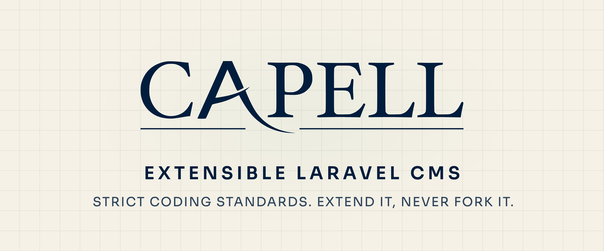

<!--
  This file is a draft of the intended content of profile/README.md in the
  capell-app/.github repository. GitHub renders that file as the
  organisation's public front page (github.com/capell-app) — but only when
  the repository hosting it is public.

  The capell-app/.github repository is public and this content is LIVE: it
  was published to capell-app/.github at profile/README.md on 2026-07-30 and
  renders today at github.com/capell-app (verified 2026-08-06). Earlier
  revisions of this comment described the repo as private and the draft as
  unpublished — that is no longer true.

  Because it is live, treat this file as the editable source and keep the two
  in sync: an edit here is not visible to anyone until it is copied to
  capell-app/.github. See docs/github-repo-surface.md, section 8.

  This copy matches the live file as of 2026-11-15. Make changes here first,
  then copy the content below this comment to capell-app/.github.
-->

# Capell

<picture>
  <source media="(prefers-color-scheme: dark)" srcset="https://raw.githubusercontent.com/capell-app/capell/main/docs/images/capell-readme-hero.jpg">
  
</picture>

**A Laravel CMS you extend, never fork.**

Capell is a Laravel CMS built from the ground up on Filament. Install it into a new or existing Laravel application, and the code, the data and the infrastructure stay yours. A guided route for deploying a Capell site into your own Laravel Cloud organisation is in progress.

It covers what you expect from a CMS: pages, media, menus, previews, multilingual sites and publishing. Beyond that, it provides the structure that keeps a long-lived site maintainable.

- **Separate layers, each with one job.** Core holds the content model. Admin is the Filament workspace where editors work. Frontend handles public routing, themes and delivery. Editing state never reaches public pages, and your application keeps its own presentation.
- **Structure you define once.** Page types, shared layouts and approved widgets let editors build polished pages without one-off templates. When you improve a page type, every page that uses it improves too.
- **Extension points instead of patches.** Packages add fields, widgets, themes, workflows and integrations through typed registries and stable contracts. You never edit Core to add a feature.
- **Verified extensions you can trust.** The MIT-licensed **Capell Foundation** is free. Every verified extension shows its migrations, data access and removal path, so you can review it before it reaches production.
- **A planned upgrade process.** Upgrades run through Capell's own commands, with logged steps, health checks and declared rollback rules. Public API baselines are tracked between releases, and you can rehearse an upgrade on a copy of your site before you apply it.
- **Page history that keeps every version.** Compare a page with an earlier version and roll back. The restore is saved as a new version, so the history you came from stays intact.
- **Readable by people and AI agents.** Every published page is also available in a form agents can read. Agents can prepare admin changes, but a person approves them before anything goes live.

[capell.app](https://capell.app) · [Documentation](https://docs.capell.app) · [Live demo](https://capell.app/demo) · [Install instructions](https://github.com/capell-app/capell/blob/main/docs/getting-started/install.md) · [Roadmap](https://capell.app/roadmap) · [X](https://x.com/capell_app)

## Start here

Start a new project from the starter kit:

```bash
laravel new my-studio --using=capell-app/starter-kit
```

Or install Capell into an existing Laravel application:

```bash
composer require capell-app/installer
php artisan capell:install
```

See the [main repository](https://github.com/capell-app/capell) for the full README, quickstart, and contribution guide.

## What Capell includes

Capell Foundation is free and MIT-licensed. The other features come from free or paid extensions in the [Capell Marketplace](https://capell.app/extensions), and you install each one only when a project needs it.

### In Foundation

- **Page editing and recovery.** Compare page revisions, then roll back or forward with the audit trail intact. Preview unsaved edits on your live theme through a private, expiring link.
- **Structured pages.** Use page types, approved layouts and a block library of reusable sections. Editors compose pages, and your templates decide how they look.
- **Multi-site and multilingual.** Run separate sites from one Laravel application, each with translated pages, menus and tags.
- **Your frontend.** Render public pages in Blade or Livewire. Vue and React through Inertia are in beta.
- **Admin and permissions.** Manage everything through 78 Filament resources and 516 explicit permissions, so each person gets only the access they need.
- **Operations from the command line.** Install, inspect, diagnose and maintain the site with 340 Artisan commands.

### Free extensions

Media Library, Navigation, Blog, Tags, sitemaps and site discovery, the HTML cache, which refreshes only the pages affected by a change, Site Monitor, cookie-light Insights analytics, a versioned JSON API, Agent Bridge for governed AI clients, Frontend Authoring, and Migration Assistant with a WordPress importer.

### Paid extensions

- **Publishing:** Publishing Studio for workspaces, review, approvals, scheduling and atomic releases.
- **Discovery:** Search, SEO Checks, Redirects and Smart 404.
- **Engagement:** Form Builder, Newsletter, Comments, Events, Bookings, Live Chat, Contacts, Campaign Studio and Experiments.
- **Access and payments:** Access Gate, Payments, Customer Portal and Privacy Center.
- **Operations:** Diagnostics, Deployments (extension installs and updates as reviewed pull requests), Login Audit and Password Policy.
- **AI:** AI Creator, Agent Delivery and Media AI. Each one is opt-in and needs editor approval.
- **Themes:** presets and themes for editorial, events, portfolios, knowledge bases, restaurants and local services.

## The foundation packages

| Package     | Composer name                                                   | What it does                                                                               |
| ----------- | ---------------------------------------------------------------- | ------------------------------------------------------------------------------------------- |
| Core        | [`capell-app/core`](https://github.com/capell-app/core)               | Laravel CMS content, publishing, extension, install, and upgrade foundations for Capell.    |
| Admin       | [`capell-app/admin`](https://github.com/capell-app/admin)             | Filament administration, page editing, recovery, settings, and operations for Capell CMS.   |
| Frontend    | [`capell-app/frontend`](https://github.com/capell-app/frontend)       | Public routing, rendering, themes, assets, and cache-safe delivery for Capell CMS.           |
| Installer   | [`capell-app/installer`](https://github.com/capell-app/installer)     | Guided browser and CLI installation for Capell CMS on Laravel.                              |
| Marketplace | [`capell-app/marketplace`](https://github.com/capell-app/marketplace) | Extension marketplace browsing and acquisition for Capell CMS.                              |

Descriptions above are copied verbatim from each package's own `composer.json`.
