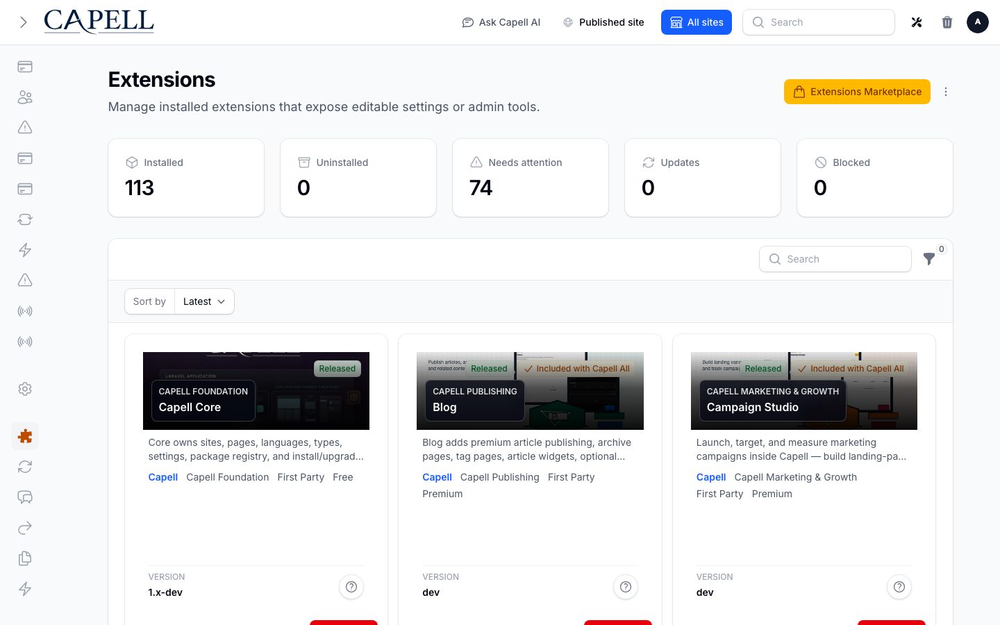

# Capell Packages and Extensions

The host package boundary and extension documentation entry points now live at [`packages/catalog.md`](packages/catalog.md).

To start a new package, run `php artisan capell:make:extension` (the deprecated alias `capell:make-extension` still works) and follow [Package authoring](platform/package-authoring.md). That page also names two published packages, [`capell-app/extension-cookbook`](https://github.com/capell-app/extension-cookbook) and [`capell-app/referer`](https://github.com/capell-app/referer), to read as working references.
