# Extension points for package authors

An extension package owns its feature code and contributes through its manifest-scoped providers. The Foundation registrars compose Core, Admin/editor, and Frontend/public surfaces; the Extension Cookbook is a concrete example of a page-schema extension and typed frontend registrations.

_A package contributes to the host through contracts; it does not copy a Core resource. Package-owned models, migrations, routes, and views remain package-owned._

The three branches are selected by the Cookbook's [provider buckets](https://github.com/capell-app/capell-packages/blob/main/packages/extension-cookbook/capell.json). Its [Admin bridge](https://github.com/capell-app/capell-packages/blob/main/packages/extension-cookbook/src/Bridges/ExtensionCookbookAdminBridge.php) registers the [page-schema extender](https://github.com/capell-app/capell-packages/blob/main/packages/extension-cookbook/src/Filament/Extenders/ExtensionCookbookPageSchemaExtender.php), which adds translated sidebar help. Its widget contribution uses optional Layout Builder, an explicit Cookbook dependency.

[Canonical Mermaid source](../images/capell-extension-package-surface-map.mmd) · [Package extension platform guide](https://github.com/capell-app/capell-packages/blob/main/docs/package-extension-platform.md)
