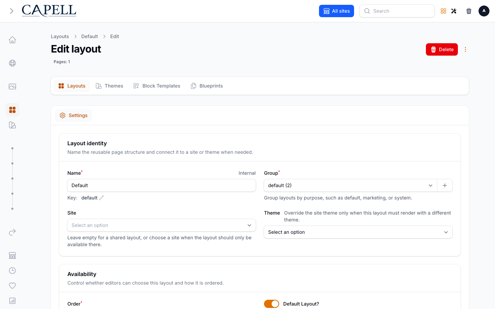

# Layout Builder

> **Heads up:** Layout Builder is an approved, optional **Capell Foundation** package. It is a Composer package you add to an app, not core host behaviour. Install it only when a site needs visual page composition.

Layout Builder is the visual layout and widget composition engine behind content-first page editing. It provides:

- Content-first, drag-and-drop page editing.
- Reusable widgets and named layout areas.
- Responsive containers for arranging content across breakpoints.
- Query-free public rendering that never leaks editor internals.

It is independent and does not depend on other add-ons. [Content Sections](content-sections.md) builds on top of it.

## Install

<!-- capell-docs-commands: optional-package -->

```bash
composer require capell-app/layout-builder
php artisan capell:layout-builder-install
```

Full documentation lives at `https://docs.capell.app/packages/layout-builder`.

## Next

Before composing a reusable layout, its edit screen sets the name, group, site, theme and availability that identify it in page selection.

<picture><source media="(prefers-color-scheme: dark)" srcset="../images/generated/admin/layout-edit-actions-dark.png"></picture>

- [Content Sections](content-sections.md) — ready-made page sections built on Layout Builder.
- [Packages and extensions](catalog.md) — host package boundaries and the full add-on catalogue.
- [Packages](README.md) — package authoring and extension points.
