# Glossary

## Editing terms

Plain-English definitions for everyday content work.

| Term | Means |
| --- | --- |
| Draft | A saved version of a page that visitors cannot see yet. You keep editing until you publish. |
| Live (published) | A page that is visible on the public site. |
| Publish | Make a page live on the public site. |
| Unpublish | Take a live page back down so visitors no longer see it. |
| Slug | The last part of a page's URL (for example `about-us`). Keep it short, lowercase, and stable. |
| Preview | A private view of how a page will look before it goes live. |
| Redirect | A rule that sends an old URL to a new one so old links keep working. |
| Alt text | A short text description of an image, used by screen readers and when the image fails to load. |
| Site switcher | The admin control for choosing which site you are currently editing. |
| Media | Uploaded files (images, documents) managed in the Media area. |
| Blueprint | The reusable definition behind a page, theme or site. Admin labels: Page blueprint, Theme blueprint, Site blueprint. Older APIs call a page blueprint a page type. |
| Site | A top-level publishing surface with its own domain(s), languages, and settings. |
| Page | The primary routable content entity. Pages belong to a site and can have one or more language translations. |
| Page URL | The site-scoped, per-language address of a page. A page keeps its old URLs as redirects when its slug or parent changes. |
| Language | A locale a site publishes in. Each language has its own page URLs and translations. |
| Layout | The template a page renders into. Changing a layout changes every page that uses it. |
| Theme | The look of a site: templates, styles and assets. Managed in **Theme Library**. |
| Theme Library | The admin screen for installed themes: **Customise → Preview → Apply**. See [Theme Library](../admin/theme-library.md). |
| Page history | The recorded versions of a page. Compare any two, preview a rollback, then roll backward or forward without erasing history. Not a backup. See [Page history and rollback](../development/page-event-history.md). |
| Clear Cache | The admin header action that refreshes cached pages and settings after a change that did not appear on the public site. |
| Peek | An optional package that previews an unsaved snapshot of the editor through the real theme. |
| Scratch recovery | Restoring an editor form from the last unsaved draft the admin kept for you. |
| Foundation | The five MIT-licensed host packages: Core, Admin, Frontend, Installer and Marketplace. Everything else is an optional package. |
| Package (extension) | A Composer package that adds a feature through Capell's extension points instead of changing core. See [Packages and extensions](../packages/catalog.md). |
| Workspace | An isolated sandbox where edits are staged, provided by the optional Publishing Studio package. One workspace may hold a single page change or hundreds of coordinated edits. |

## Developer terms

Implementation-level definitions for package and theme authors.

| Term | Means |
| --- | --- |
| Draft | A page whose publishing state is `draft` (`PublishVisibilityStateEnum::draft`): its `visible_from` date holds the far-future draft placeholder, so visitors cannot see it. This needs only Foundation. A page row staged inside a Publishing Studio workspace (non-zero `workspace_id`) is also treated as a draft by the admin, but that is a separate, optional storage model; see Workspace. |
| Live | A page whose publishing state is `published`: its visibility window has started and not ended. When Publishing Studio is installed, the live row also carries `workspace_id = 0`. |
| Draftable model | Any Eloquent model that participates in the workspace system. Draftable models use the `BelongsToWorkspace` trait. See the [Draftable contract](https://docs.capell.app/publishing-studio-draftable-contract/). |
| Workspace | An isolated sandbox where edits are staged. Provided by the optional Publishing Studio package (`Capell\PublishingStudio\BelongsToWorkspace`), not by Foundation. See [PublishingStudio & Versions](https://docs.capell.app/publishing-studio/). |
| Version | An immutable snapshot of the live manifest at a point in time. Publishing a workspace creates a new version and flips it live. |
| Publish | The atomic flip that promotes a workspace's draft rows to live. Runs publish-checks (freshness, URL collisions, release windows) inside a single transaction. |
| Rebase | Bringing a stale workspace up to date after another workspace has published. See [Rebase flow](https://docs.capell.app/publishing-studio/#rebase-flow). |
| Rollback | Restoring the previous live version after a publish. Also available per-row via `EntityRollbackAction`. |
| Approval level | An integer count of approvers required before a workspace can publish. Defaults to `2`; override via `settings.required_approval_levels`. |
| Schema | A Filament field schema class that defines the form for a blueprint, setting, or resource. |
| Schema hook extender | A class that injects extra form fields at named positions in an existing schema, without overriding the full schema. See [Extending Capell §4](https://docs.capell.app/extending-capell/#4-schema-hook-extenders). |
| Render hook | A registered extension that injects HTML into a named location inside a frontend Blade component. See [Render Hooks](https://docs.capell.app/extending-render-hooks/). |
| Event registry | The Admin package's event bus for subscribing to admin lifecycle events (e.g. `afterSave`). See [Extending Capell §5](https://docs.capell.app/extending-capell/#5-event-registry-callbacks--subscribers). |
| Settings Schema Registry | Runtime registry of the settings form schemas shown on the admin **Settings** page. See [Settings Schema Registry](https://docs.capell.app/packages/admin/settings-schema-registry/). |
| `Layout` (core model) | The theme-scoped template structure a page renders into (`Capell\Core\Models\Layout`). An ordered, theme/site-scoped template record with a status flag, a default flag, and an attached image, selected per page. Part of core. |
| Layout Builder | The optional `capell-app/layout-builder` package: containers, layout widgets and widget assets composed into a page layout. It builds on the core `Layout` model above. **Not part of core.** See [Layout Builder](../packages/layout-builder.md). |
| Layout widget | A reusable rendered unit placed in a named area of a layout, owned by Layout Builder. Distinct from a body block. |
| Body block | A typed, reorderable unit inside a page body, chosen when the page type or the page's `content_structure_override` selects blocks. The block types come from the optional Block Library package. See [Build a page](../getting-started/building-pages.md). |
| Content Sections | The optional `capell-app/content-sections` package: ready-made, themeable page sections (hero, FAQ, pricing and so on). It requires Layout Builder but is a separate package. **Not part of core.** See [Content Sections](../packages/content-sections.md). |
| Migration package archive | A portable archive containing exported content, manifest data, payloads, and integrity checks that can be re-imported through the Recovery Center when `capell-app/migration-assistant` is installed. See [Recovery Center](../admin/recovery.md). |
| Static HTML cache | Rendered HTML written to disk and served directly by the web server before PHP runs. See [HTML Caching](https://docs.capell.app/cache/). |
| Render hook context | The `RenderHookContext` DTO passed to every render-hook extension, exposing the location, the current item, and any extra data the host component provides. |
| Workspace context | The active workspace for a request, set either by the admin switcher (session) or a signed preview link (cookie). Driven by the `ResolveWorkspaceContext` middleware. |

The Draft, Live, Publish, Version, Rebase and Approval level rows above describe the optional Publishing Studio package where they mention workspaces; a Foundation-only install has the editing-term meanings.

## Next

- [Learn Capell](../getting-started/capell-learn.md) to return to the guided path.
- [Core relationship map](core-erd.md) for the fuller model.
