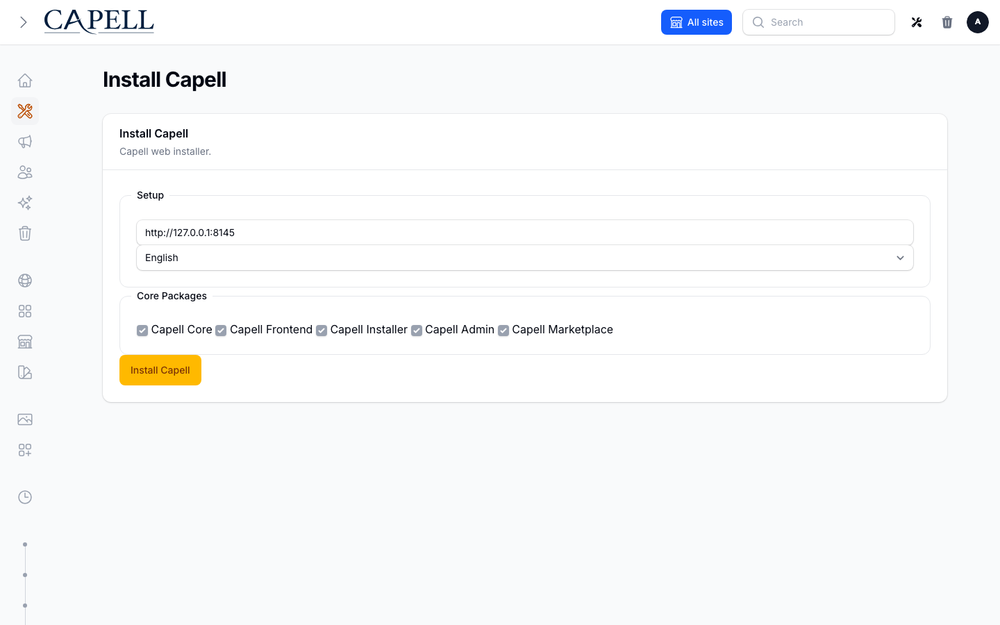
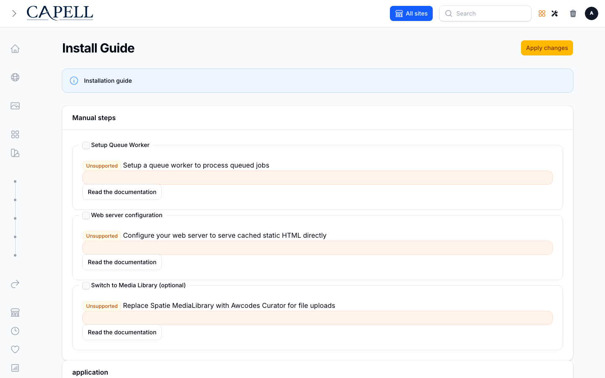

# Capell Installer

## What This Package Adds

**Available. Foundation package. No schema impact. Hidden from Marketplace listings.**

Capell Installer provides the temporary browser setup surface for a new Capell application. It collects install input, runs preflight checks, delegates install work to Core Actions, shows progress and reports, applies install guide patches, and removes itself after setup.

After install, a site operator can open `/install`, select safe setup options, run browser-based setup steps, review progress, download the report, and remove the installer package. The package is intended for bootstrap only; production sites should remove it after setup.

Installer extends these Capell surfaces:

- Public bootstrap routes under `/install` before the site is installed.
- Filament setup pages and dashboard warning while the installer is present.
- Core install Actions through browser step orchestration.
- Install guide patch registry for idempotent host-file setup tasks.
- Cache-backed installer session state for progress, locking, and reports.

## Why It Matters

- **For developers:** Installer keeps bootstrap concerns outside Core. It gives package and app setup a browser flow, preflight checks, patch contracts, typed install input, progress storage, and cleanup Actions.
- **For teams:** Non-technical operators can complete first-run setup with visible checks and reports, while developers still have command-line and testable Action boundaries underneath.

## Screens And Workflow

Select either screenshot to open the full-resolution image.

| Installer                                                                                                                                                                                                                                                                                                                                                         | Install guide                                                                                                                                                                                                                                                                                                                                                |
| ----------------------------------------------------------------------------------------------------------------------------------------------------------------------------------------------------------------------------------------------------------------------------------------------------------------------------------------------------------------- | ------------------------------------------------------------------------------------------------------------------------------------------------------------------------------------------------------------------------------------------------------------------------------------------------------------------------------------------------------------ |
| <picture><source media="(prefers-color-scheme: dark)" srcset="images/screenshots/install-capell-page-dark.png"></picture> [Light](images/screenshots/install-capell-page.png) · [Dark](images/screenshots/install-capell-page-dark.png) | <picture><source media="(prefers-color-scheme: dark)" srcset="images/screenshots/install-guide-page-dark.png"></picture> [Light](images/screenshots/install-guide-page.png) · [Dark](images/screenshots/install-guide-page-dark.png) |

Screenshot contract:

- Admin index screen: not applicable before setup. Installer may show an Admin dashboard warning while installed.
- Create/edit screen: the `/install` form collects setup input.
- Settings/configuration screen: install guide patches and preflight checks show setup requirements.
- Frontend output: not applicable.
- Package detail or install intent screen: not applicable.
- Carousel steps: setup progress uses browser step requests and progress/report surfaces.

## Technical Shape

- Service provider: `Capell\Installer\Providers\InstallerServiceProvider`.
- Config: installer options, binary paths, reinstall allowance, Composer settings, package defaults, and setup environment values.
- Migrations and models: no package-owned tables or models.
- Filament pages: setup and warning surfaces for installed admin contexts.
- Livewire components: installer UI components for guide and progress behaviour.
- Routes: `/install`, `/install/run-step`, cancellation, progress, progress data, report download, success, and installer deletion routes.
- Policies/permissions: route access is guarded by install state and session ownership rather than normal admin permissions.
- Events/listeners: install progress is reported through Core and installer progress reporters.
- Jobs/queues/schedules: queued install is supported when the host queue is available; browser step mode is the normal flow.
- Blade views/components: installer pages, progress UI, report UI, and guide patch presentation.
- Cache behaviour: install input, plan, progress, locks, and report access use `capell.install.{installId}.*` cache keys.
- Extension hooks: install guide patches implement the Core-owned `Capell\Core\Support\Patching\Patch` contract and register with `PatchRegistry`; install-time patches are also contributed to Core's `InstallPatchRegistry`.

## Installer JavaScript Modules

The installer view loads its inline modules in this order: `install/support.js`,
`install/wizard.js`, `install/packages.js`, `install/form-options.js`,
`install/progress.js`, `install/csrf.js`, `install/runner.js`, then `install.js`.
Each module uses an IIFE that adds a factory or support object to the
`globalThis.CapellInstaller` namespace. `install.js` is the composition root: it
reads the form and config, creates the factories, wires selection changes, and
starts the runner only after client-side validation.

`#capell-installer-config` is a JSON script element. Its contract is
`requirementsMap`, `themePackageNames`, `installedThemeKeys`, and translated
`messages`; package selection relies on the first three, while the factories use
the message keys for labels and failures. Keep a new module dependency earlier
than the module that consumes its namespaced factory.

CSRF handling has two deliberate policies. Starting an install refreshes the
token before the initial form request; a `419` from that request refreshes once
and retries once, then returns the user to the form. Step requests send the
current token and accept replacement `csrfToken` values from responses, but a
`419` is a hard expired-session failure with no automatic retry.

Browser step requests acquire an owner-aware execution lease. If a disconnected
request is still running, a duplicate response has `inProgress: true`; the browser
polls the same step without marking it complete. A repeated request after commit
returns the next persisted step. Cancellation or replacement prevents an old
request from committing resolved-user, completion or failure state when it returns;
it does not undo work the executing command has already performed.

Queued failures keep their active lock and `queued` status during retry backoff.
Exhaustion marks the run failed and releases only that run's lock. A superseded
attempt cannot clear its replacement's lock or overwrite cancellation. The latest
run identity remains cached for the same window, so a failed browser run cannot
resume after its replacement has completed and released the active lock.

## Deploying Changes To Installer Execution

Drain installer execution before switching releases that change admission or state
commit guards. An HTTP request or queue job already executing old code retains its
old behaviour, even after its run is cancelled by new code.

1. Block new installer starts and step requests on every serving node at the
   ingress, and pause queue consumers that can admit installer jobs. Keep that
   admission block in place throughout the release switch.
2. Wait for every in-flight installer HTTP request and queue job to finish. Check
   the serving process manager and queue worker state on all nodes; a cancelled
   cache status or an empty active lock does not prove execution has drained.
   If execution cannot be confirmed idle, keep installer admission closed and
   postpone the switch. Do not clear locks or terminate work to bypass this gate.
3. Switch the release, restart retained PHP/Octane and queue processes, and confirm
   every node runs the new code before restoring queue consumption and installer
   admission. Refresh open installer pages before continuing setup.

A queue restart signal permits the current job to finish. A page refresh does not
stop an already executing HTTP request. Neither replaces the drain gate above.
The installer cache protocol cannot fence an old binary that lacks these guards.

## Data Model

Installer owns no data tables.

Runtime state is cache-backed:

- Install input and plan for the active browser setup.
- Progress lines and status from file and cache progress reporters.
- Lock state that prevents overlapping installs.
- Report access for the browser session that started the install.

Migration impact:

- No Installer migrations.
- Installer delegates schema creation to Core and selected packages during setup.

Deletion and retention:

- Cancellation purges executable input and the active plan. The download retains
  a separate redacted snapshot of the original plan, completed steps, preflight,
  diagnostics and output for the existing two-hour cache window. It cannot resume
  the cancelled install, and access still requires the originating browser session.
- Reports retain the existing bounded diagnostic output, including terminal errors
  beyond 500 progress entries. Late diagnostics and exceptions append to the
  cancelled report while the executor unwinds, without restoring executable input.
  The combined output keeps the most recent complete lines within 256 KiB and
  reports omitted line counts when late additions exceed that bound. Each new
  output line is limited to 8 KiB. Input secrets and labelled credentials are
  redacted; only an encrypted redaction dictionary survives input cleanup.
- Cache entries expire after the configured install window.
- Removing the package deletes the installer code path, not the installed site content.

## Install Impact

- Admin navigation: adds setup-related warning/surfaces only while the installer package is present.
- Permissions: no permanent permissions.
- Public routes: registers bootstrap `/install` routes until the package is removed.
- Database changes: none directly; install steps may run Core and package migrations.
- Config keys: install binaries, reinstall allowance, setup defaults, Composer paths, and package selection settings.
- Queues or scheduled tasks: optional queued install support when the queue is configured.
- Cache tags or invalidation paths: installer progress, lock, input, plan, and report cache keys.

## Common Pitfalls

- `/install` should not remain available after production setup. Remove the package from the success screen or Composer.
- Reinstall is blocked when Admin is installed, the `sites` table exists, and at least one site exists, unless `APP_DEBUG=true` and `CAPELL_SETUP_ALLOW_REINSTALL` is true.
- Web PHP must be able to run the configured PHP, Composer, and Git binaries for browser installs.
- Database-backed sessions or cache can fail before tables exist; the provider falls back per request when safe.
- Composer package choices are shown only when the web PHP process can resolve the package.
- Guide patches must be idempotent and covered by focused tests.
- Install Guide requires **Review changes** before **Apply changes**. Review is read-only: it shows affected relative paths, bounded before/after edits with host literal values redacted, and the backup or file-creation recovery plan. The server binds a review to the current actor, selection and source fingerprints for 15 minutes. Changing the selection, source contents or file permissions requires a fresh review. Applying consumes the review, including on failure.
- Patches may opt into Core's `Capell\Core\Support\Patching\ReviewablePatch` capability without changing the existing `Patch` interface. `preview()` returns `PatchPreviewData`; `recoveryResult()` returns `PatchRecoveryData` with actual backup and created-file paths, including partial failures. Keep raw source contents server-side and use the same patch-owned plan for preview and application. Patches without this capability, or whose current state cannot be previewed safely, remain explicit manual steps in the reviewed browser flow. Existing command-line patch entry points retain their applicability safeguards.
- Results remain visible after patch statuses refresh. Existing files are backed up before writing; newly created files are listed separately with instructions to reverse their creation. Multiple edits within the same second retain separate backups. A failed write never counts as a success or a skipped patch.

## Quick Start

1. Install the package with `composer require capell-app/installer`.
2. Open `/install`, complete preflight checks, run setup, and let the installer delegate to Core.
3. Verify the success report, then remove the installer package from the success screen.

## Next Steps

- Run `vendor/bin/pest packages/installer/tests --configuration=phpunit.xml` after changing installer routes, validation, preflight, patches, session state, or cleanup.
- Run `npm run test:installer-browser` after changing browser flow or CSRF retry behaviour.
- Run `npm run screenshots` and `npm run screenshots:check` after visual installer changes.
- Review patch implementations under `packages/installer/src/Support/InstallGuide`.
