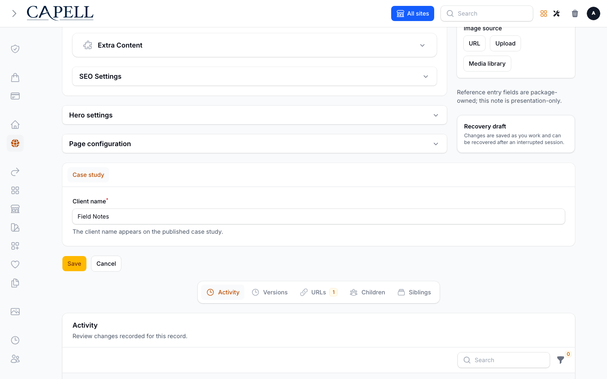

# Custom page-field screenshot fixture

The Case study field uses the real page schema extender, normal PageResource editor and persisted page metadata. The public example uses the normal anonymous page route and a hydrated public render-data contribution.

The additional sidebar note comes from the exact pinned Extension Cookbook source in `../extension-cookbook/`, loaded as a fixture. This proves that the real contribution composes with the app field; it does not claim that the companion package was installed.

The four screenshot scenarios have independent records to avoid ordering or concurrency dependencies. The reopened editor changes its client through the real Save control and follows the existing record breadcrumb to reopen the persisted record. The public example is independently seeded as Field Notes Studio. The same-record save/reopen/logout/public behaviour is verified separately by `tests/Feature/Documentation/CustomPageFieldsWorkflowTest.php`.

The screenshot provider uses the supported `Table::configureUsing()` / `columnManager()` API to disable only the Activity column chooser for the four exact screenshot records with the Case study blueprint. Its deferred condition returns `null` for every other owner, preserving Filament’s automatic defaults. All Activity rows, relation managers, canonical editor routes, authorisation and save behaviour remain intact.

The original owned-runtime capture exposed Alpine column-manager errors in ActivityHistoryRelationManager after a Livewire save. Its failed HTML/JSON/PNG/trace artefacts are retained in private task evidence as a baseline limitation. Production table code is unchanged and runner diagnostics remain strict. A focused behaviour check proves that the chooser is disabled only on the named fixture records while Activity rows and the ordinary Case study chooser remain available.

_The named screenshot fixture retains the real editor and Activity rows; only its column chooser is disabled._
